<!-- First: Set your default preferences for chunk options: -->

<!-- If you want a chunk's code to be printed, set echo = TRUE. message = FALSE stops R printing ugly package loading details in your final paper too. I also suggest setting warning = FALSE and checking for warnings in R, else you might find ugly warnings in your paper. -->

```{r setup, include=FALSE}
knitr::opts_chunk$set(echo = FALSE, message = FALSE, warning = FALSE, fig.width = 6, fig.height = 5, fig.pos="H", fig.pos = 'H',out.width = "100%")

pacman::p_load(PerformanceAnalytics, tidyverse, rmsfuns, tbl2xts, rugarch, kableExtra, fredr,
               scales)

list.files('../code/', full.names = T, recursive = T) %>% .[grepl('.R', .)] %>% as.list() %>% walk(~source(.))

```


# Part A: How has volatility increased?

## Global implied volatility
- The VIX, V2X and VXEEM move closely together, so global volatility is highly synchronised.
- The largest spikes were the GFC (V2X above 110) and COVID in 2020 (V2X and VXEEM above 90).
- Smaller spikes followed in 2022, early 2025 (VIX around 50) and 2026. The 2026 spike was largest in emerging markets (VXEEM mid-40s).
- Since 2023 the indices have mostly sat between 15 and 25.
- Volatility is episodic and mean-reverting. Recent spikes are well below the GFC and COVID, so there is no sustained structural increase.

```{r}
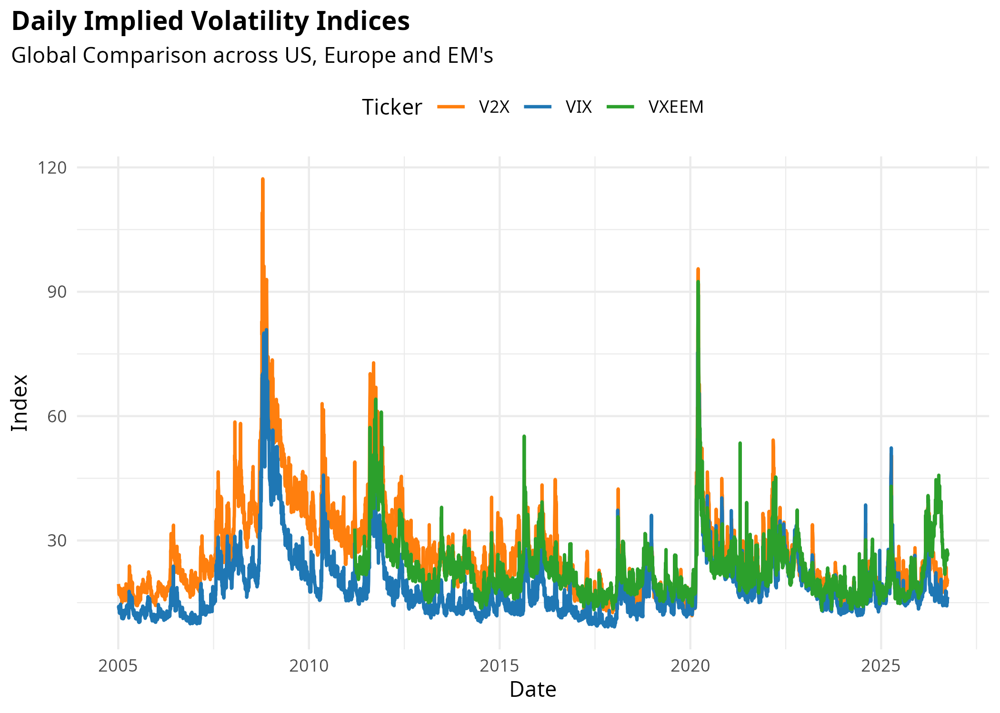
```

## Daily returns
- Returns show volatility clustering: calm periods are interrupted by clusters of large moves.
- The largest daily moves were in March 2020 (roughly ±8–10%). Recent large down days of about 5–6% occurred in 2025 and 2026.
- The pattern is similar across the JSE indices (J200, J201, J202, J433) and the Capped SWIX style indices.

```{r}
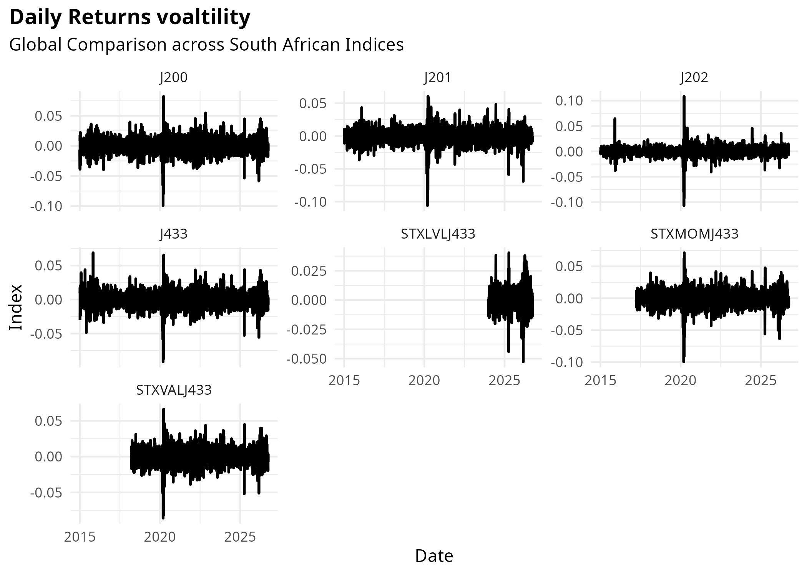
```

## Rolling volatility
- The 120-day annualised volatility of SA indices usually sits between 10% and 20%.
- It peaked at about 40–43% in 2020, with smaller episodes in 2016, 2022 and 2025–26 (roughly 20–26%).
- All indices rise together, and the style indices track the J433 closely. J202 is generally the least volatile.
- SA volatility is currently elevated compared with 2023–24 but far below 2020, so it is not trending upward.

```{r}
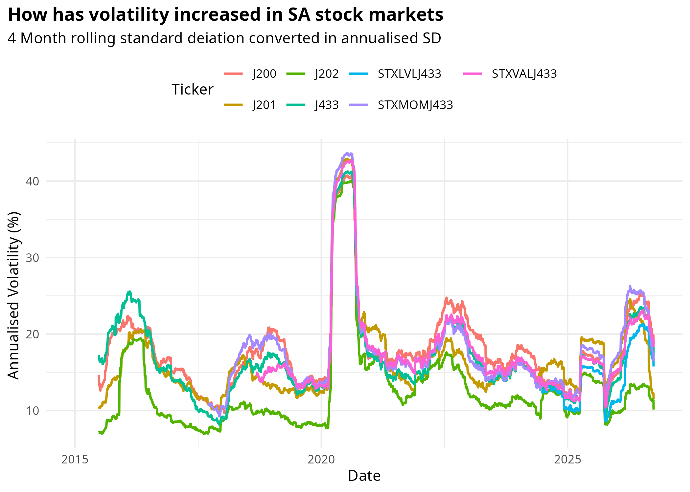
```

## Spillovers (DCC-GARCH)
- Correlations between the Capped SWIX and the MSCI indices are positive and fairly stable. They are highest for Europe (about 0.6) and lowest for Japan (about 0.2–0.3).
- Correlations rise in stress, most clearly in COVID (Europe about 0.8, the others 0.4–0.6), with smaller rises around 2025–26.
- There is no clear long-run upward trend, so the rises are temporary.
- Diversification across markets therefore weakens when it is needed most.

```{r}
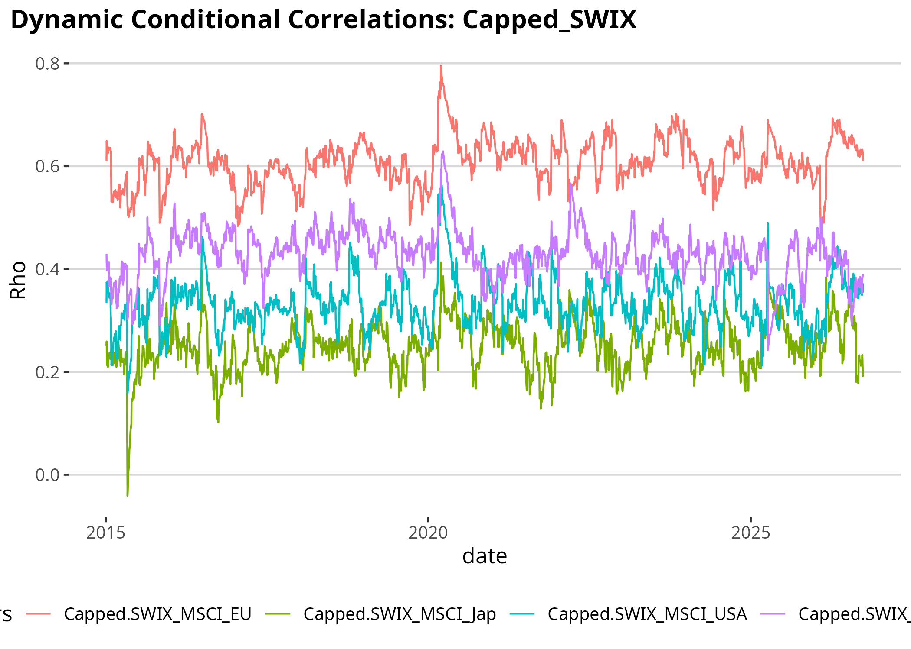
```

## Implication for SafeCore
Volatility is spiky, and the main stress episodes (2020 and 2025–26) are the real test of how SafeCore handles it. Part B examines this.


# Part B
# Did SafeCore navigate volatility well?

**Table 1: SafeCore vs Capped SWIX, 2015-01-02 to 2026-09-30 (daily data, annualised with 252 days)**

| Metric                        | SafeCore | Capped SWIX |
|:------------------------------|---------:|------------:|
| Annualised return (%)         |    10.75 |        8.65 |
| Annualised volatility (%)     |    17.84 |       17.84 |
| Return / volatility           |     0.60 |        0.49 |
| Skewness                      |    -0.41 |       -0.44 |
| Excess kurtosis               |     4.94 |        6.72 |
| Max drawdown (%)              |   -38.99 |      -41.66 |
| Downside deviation (%, ann.)  |    12.56 |       12.65 |
| Worst day (%)                 |    -8.67 |       -9.17 |
| Positive days (%)             |    52.13 |       52.06 |
| Beta to Capped SWIX           |     0.95 |             |
| Tracking error (%, ann.)      |     5.66 |             |
| Information ratio             |     0.37 |             |
| Up capture (%)                |    99.13 |             |
| Down capture (%)              |    97.04 |             |

<!-- INSERT HERE: rolling 250-day volatility plot (SafeCore vs Capped SWIX), if you ran that chunk -->

- **No volatility reduction.** Both volatilities are 17.84% and beta is 0.95. This is expected, since volatility is not an input to SafeCore's construction.
- **Better return per unit of risk.** SafeCore earned about 2.1 percentage points more per year, lifting return/volatility from 0.49 to 0.60.
- **Slightly better tail outcomes.** Max drawdown was 39.0% against 41.7%, the worst day was milder and excess kurtosis was lower (4.94 vs 6.72). Downside deviation is almost identical.
- **Little protection.** Capture ratios of 99% (up) and 97% (down) show the fund moves almost one-for-one with the benchmark. The 3-point downside advantage is small.
- **Weak evidence of skill.** An information ratio of 0.37 over about 11.75 years implies a t-statistic of roughly 1.3, so the outperformance is not statistically convincing.

**Table 2: Average monthly return (%) by volatility regime**

| Regime                             | Months | SafeCore | Capped SWIX | Difference |
|:-----------------------------------|-------:|---------:|------------:|-----------:|
| High global vol (top quartile VIX) |     36 |     0.93 |        0.84 |       0.08 |
| Other months                       |    105 |     0.94 |        0.77 |       0.17 |

- SafeCore's advantage over the benchmark is smaller in high-volatility months (+0.08 vs +0.17 percentage points per month). That is the opposite of protection, although both gaps are small.
- **Verdict:** SafeCore tracked the market's volatility rather than navigating it, with modest outperformance and a slightly shallower drawdown.

## . Where does the volatility come from?

#### Stocks and sectors (latest rebalance, 250-day covariance)

**Table 3: Top 10 stocks by contribution to portfolio variance**

| Stock | Sector        | Weight (%) | Risk contribution (%) | Beta to portfolio |
|:------|:--------------|-----------:|----------------------:|------------------:|
| ANG   | Resources     |      11.97 |                 27.76 |              2.32 |
| GFI   | Resources     |       7.48 |                 17.25 |              2.31 |
| VAL   | Unclassified* |       4.42 |                 10.41 |              2.36 |
| MTN   | Industrials   |       8.80 |                  6.30 |              0.72 |
| SBK   | Financials    |      10.13 |                  6.18 |              0.61 |
| PAN   | Unclassified* |       2.75 |                  5.74 |              2.09 |
| ABG   | Financials    |       7.23 |                  4.12 |              0.57 |
| BHG   | Resources     |       4.69 |                  3.53 |              0.75 |
| FSR   | Financials    |       5.15 |                  3.14 |              0.61 |
| SSW   | Resources     |       0.99 |                  2.44 |              2.47 |

*Sector missing in the data. VAL and PAN are precious-metals miners.

```{r}
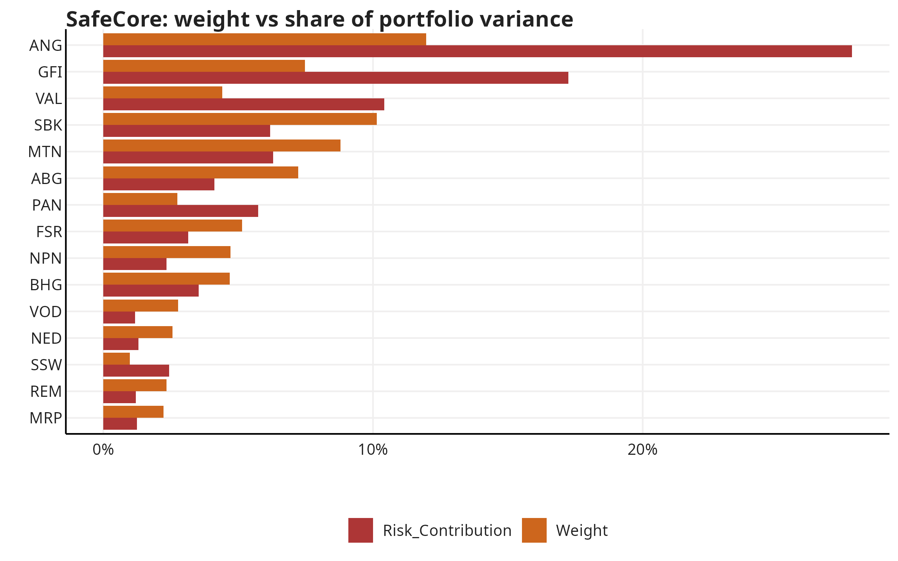
```

- **Risk is far more concentrated than weights.** Five gold and platinum miners (ANG, GFI, VAL, PAN, SSW) are 27.6% of the fund by weight but 63.6% of its variance.
- Their betas to the portfolio are 2.1 to 2.5, so each 1% of weight carries about 2.3% of portfolio variance.
- Financials and industrials are the opposite. SBK, ABG, FSR and MTN have betas of 0.6 to 0.75 and contribute less risk than their weights.

**Table 4: Sector contribution to portfolio variance**

| Sector        | Weight (%) | Risk contribution (%) | Risk / weight |
|:--------------|-----------:|----------------------:|--------------:|
| Resources     |      32.98 |                 52.01 |          1.58 |
| Financials    |      31.34 |                 17.73 |          0.57 |
| Unclassified* |       7.17 |                 16.15 |          2.25 |
| Industrials   |      25.98 |                 13.25 |          0.51 |
| Property      |       2.53 |                  0.86 |          0.34 |

- Resources are 33% of weight but 52% of risk. Counting the two unclassified miners as Resources gives 40% of weight and 68% of risk.

### Statistical factors (PCA)

```{r}
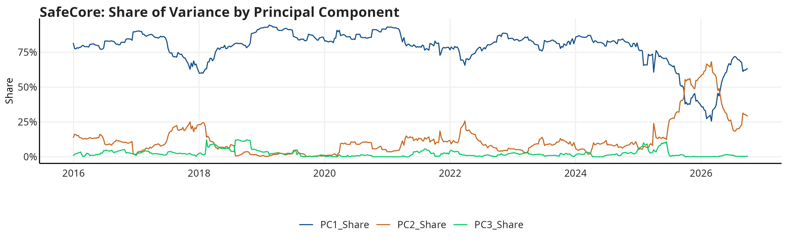
```


- At the latest rebalance, PC1 accounts for about 88% of portfolio variance and PC3 about 7%. Every other component is 2% or less.

```{r}
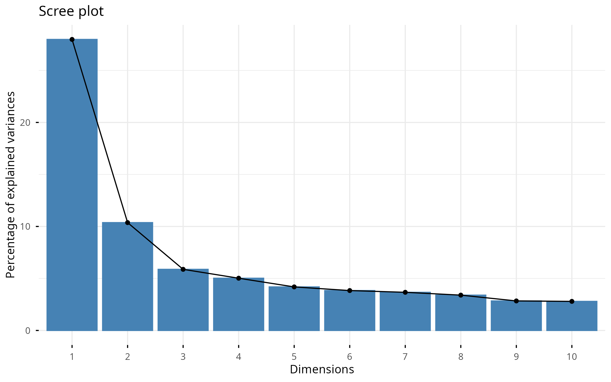
```

```{r}
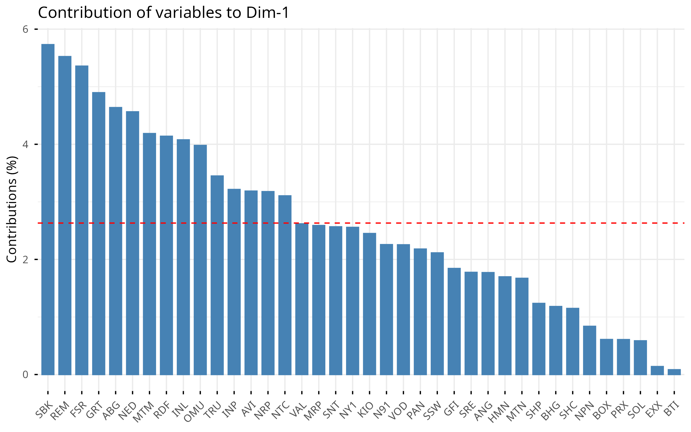
```

- Across the stock universe, PC1 explains about 28% of variance and PC2 about 10.4%.
- PC1 is a broad domestic factor, led by financials and property (SBK, REM, FSR, GRT, ABG, NED).
- PC2 is the precious-metals factor (ANG, GFI, SSW, PAN, VAL). SOL and BTI point away from the main cluster, which marks them as diversifiers.
- The portfolio arrow lies between PC1 and PC2, so SafeCore is exposed to both the market and the metals factor.
- The portfolio's PC1 share (61%) is higher than the scree plot's 28% because the portfolio is a weighted average, so stock-specific noise cancels and the common factors dominate.


### Through time

<!-- INSERT HERE: share_port_var_pc.png, then SafeCore_eff_num_bets.png -->
```{r}
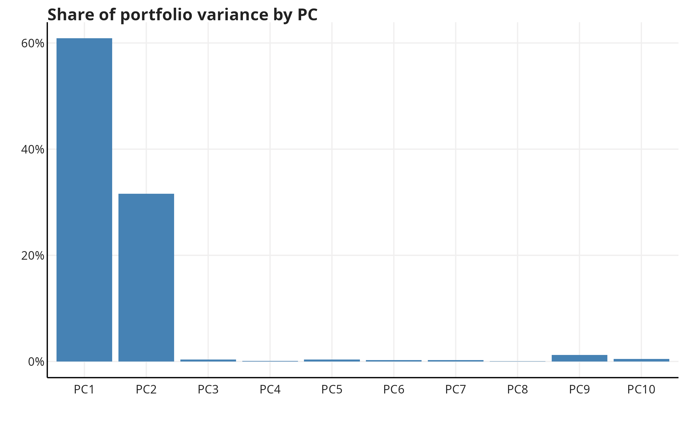
```

```{r}
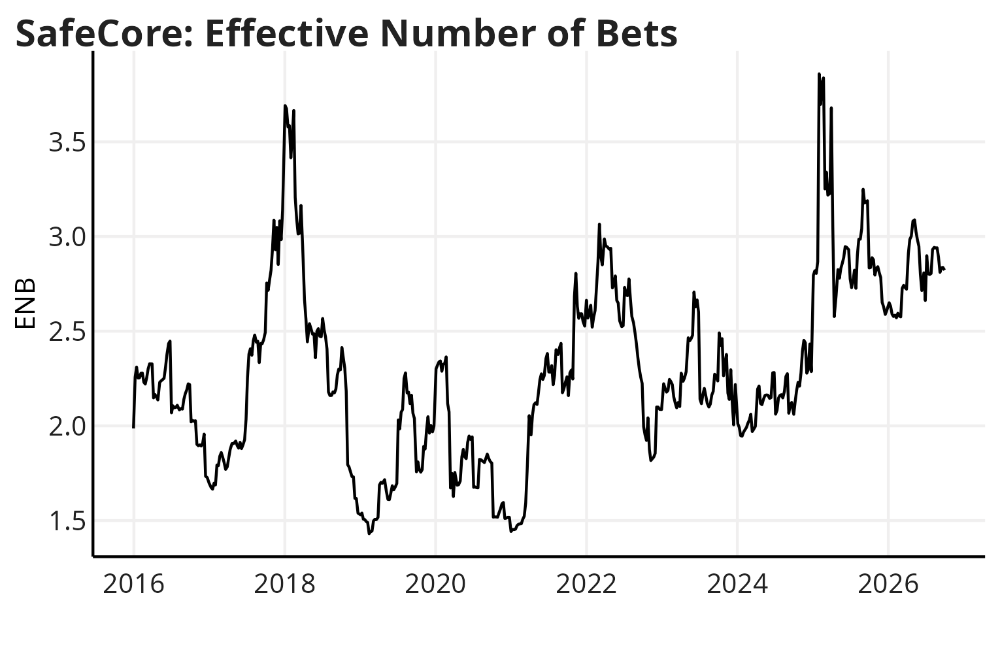
```

- From 2016 to 2024, PC1 explains most of SafeCore's variance (about 75% to 93%), with dips to about 60% to 65% in 2018 and 2022.
- In 2025 and 2026 the picture changes: PC2 rises to about 55% to 68% around late 2025 to early 2026, while PC1 falls to about 26%. By the end of the sample the split is about 63% and 30%.
- ENB mostly sits between 1.5 and 2.5, with troughs in early 2019 and early 2021 (about 1.45) and peaks in early 2018 (about 3.7) and early 2025 (about 3.85).
- Since 2025, ENB has been higher (about 2.6 to 3.3). This is because the precious-metals factor has become a second major source of risk, not because risk has fallen.
- COVID is not a special episode in the ENB series, so there is no evidence that concentration changes in a stress period in general.

##  Diversifiers and concentrators

A stock's risk contribution divided by its weight equals its beta to the portfolio. A beta below 1 means it reduces concentration relative to its size. Positions under 0.5% are excluded.

**Table 5: Lowest and highest portfolio betas**

| Type         | Stock | Sector      | Weight (%) | Risk contribution (%) | Beta to portfolio |
|:-------------|:------|:------------|-----------:|----------------------:|------------------:|
| Diversifier  | BTI   | Industrials |       0.81 |                 -0.13 |             -0.16 |
| Diversifier  | SOL   | Resources   |       4.84 |                 -0.52 |             -0.11 |
| Diversifier  | SHP   | Industrials |       2.06 |                  0.41 |              0.20 |
| Diversifier  | NRP   | Property    |       1.07 |                  0.25 |              0.23 |
| Diversifier  | EXX   | Resources   |       1.68 |                  0.44 |              0.26 |
| Diversifier  | AVI   | Industrials |       0.99 |                  0.34 |              0.35 |
| Diversifier  | PRX   | Industrials |       1.35 |                  0.51 |              0.37 |
| Diversifier  | INL   | Financials  |       0.58 |                  0.24 |              0.41 |
| Diversifier  | VOD   | Industrials |       2.78 |                  1.17 |              0.42 |
| Diversifier  | NTC   | Industrials |       0.52 |                  0.22 |              0.43 |
| Diversifier  | SBK   | Financials  |      10.13 |                  6.18 |              0.61 |
| Diversifier  | FSR   | Financials  |       5.15 |                  3.14 |              0.61 |
| Diversifier  | MTN   | Industrials |       8.80 |                  6.30 |              0.72 |
| Diversifier  | BHG   | Resources   |       4.69 |                  3.53 |              0.75 |
| Diversifier  | KIO   | Resources   |       1.34 |                  1.12 |              0.84 |
| Concentrator | PAN   | Unclassified* |     2.75 |                  5.74 |              2.09 |
| Concentrator | GFI   | Resources   |       7.48 |                 17.25 |              2.31 |
| Concentrator | ANG   | Resources   |      11.97 |                 27.76 |              2.32 |
| Concentrator | VAL   | Unclassified* |     4.42 |                 10.41 |              2.36 |
| Concentrator | SSW   | Resources   |       0.99 |                  2.44 |              2.47 |

- Only five positions have a beta above 1, and they are all precious-metals miners. All the other positions of at least 0.5% sit between -0.16 and 0.84.
- SOL (4.8% weight) and BTI have negative betas. SOL is the most useful diversifier because it is a meaningful position.
- The large positions SBK, MTN and FSR also diversify, since they contribute less risk than their weight.

##  Conclusion

- **Navigation:** SafeCore did not reduce volatility relative to the Capped SWIX. It matched it, with near-one capture ratios, slightly better returns and a slightly shallower drawdown.
- **Source of risk:** about five precious-metals miners drive roughly 64% of portfolio variance, and one factor explains about 88% of it.
- **Diversification:** it exists (SOL, BTI, the financials and defensives) but is not working systematically. It only appears in stress, when the miners decouple.
- **Recommendation:** since volatility is not a construction input, add an explicit risk budget (for example a cap on any stock's or sector's share of variance), monitor ENB, and review the miners' weights.
- **Limitations:** the sample is short, PCA windows overlap, covariance and correlation PCA differ, missing returns are set to zero, and two sectors are unclassified. The factor exposures section explains why the tilts exist.


## Part C: Dispersion, correlation and the opportunity for stock selection

## Cross-sectional dispersion

```{r}
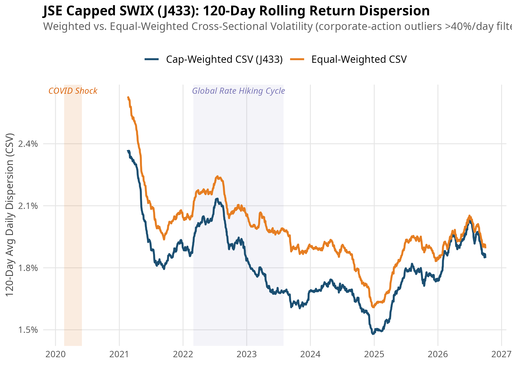
```


- Cross-sectional volatility (CSV) measures how far individual stock returns spread around the index on a typical day. Higher dispersion gives stock selection more room to add (or lose) value.
- Both series fall sharply through 2021 (equal-weighted about 2.7% to 1.9%, cap-weighted about 2.4% to 1.8%), rise during the 2022 hiking cycle, and reach a trough at the end of 2024 (cap-weighted about 1.5%).
- Dispersion recovers to about 2.0% by mid-2026, and the two measures converge. Large caps are now about as dispersed as the average stock.
- Equal-weighted CSV is above cap-weighted CSV throughout, so smaller constituents have more idiosyncratic returns.

## Correlation and systemic absorption

```{r}
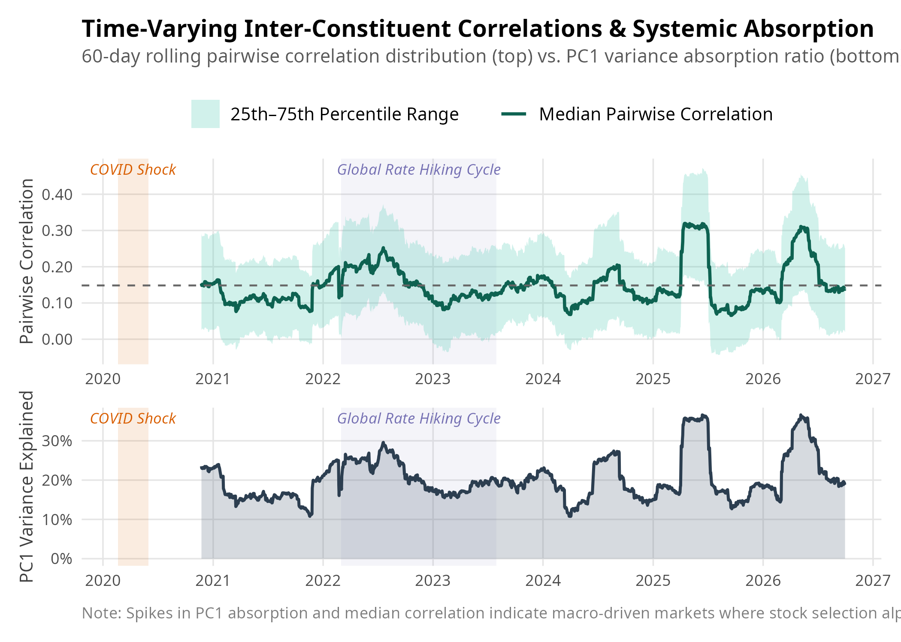
```

- Median 60-day pairwise correlation is usually 0.10–0.20, with spikes to about 0.25 in 2022 and above 0.30 in April–June 2025 and mid-2026.
- PC1 variance absorption moves with it: typically 12–25%, peaking at about 36% in 2025 and 2026.
- In these episodes stocks move together, so the market is macro-driven and stock selection matters less.

##  Alpha-opportunity regimes

```{r}
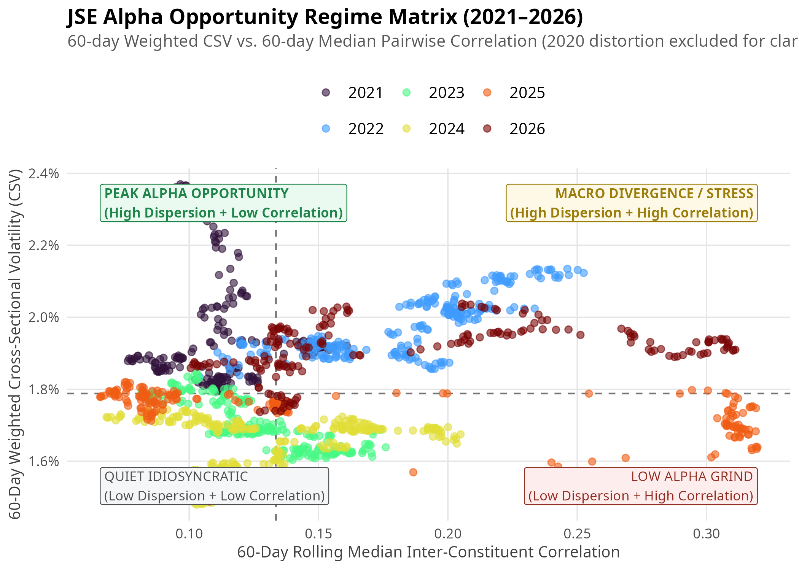
```

- **2021:** high dispersion with low correlation (CSV up to 2.4%, correlation about 0.09–0.12). This is the best environment for stock picking.
- **2022:** high dispersion with rising correlation (about 0.15–0.25), a macro-divergence/stress regime.
- **2023–2024:** low dispersion at low to moderate correlation, a quiet, low-alpha period.
- **2025:** mostly low dispersion, and the high-correlation points sit in the low-alpha quadrant.
- **2026:** dispersion of about 1.9–2.0% with correlation up to 0.31, back in the macro-divergence/stress quadrant.

##  Macro drivers


```{r}
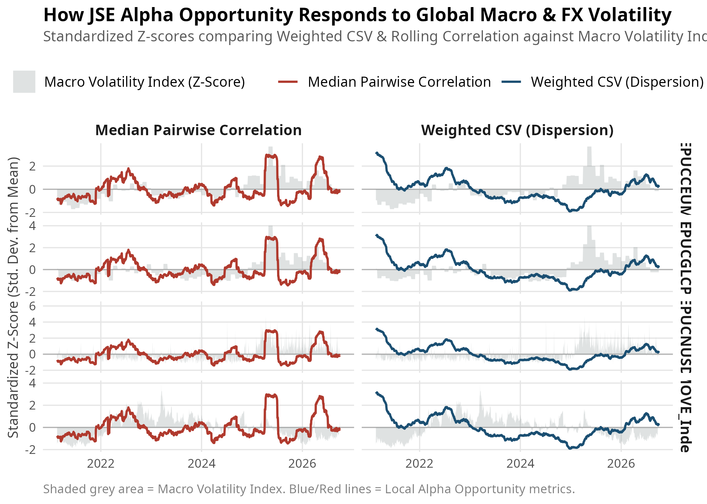
```


- The 2025 and 2026 spikes in correlation line up with spikes in the global macro volatility indicators, but dispersion does not react in the same way. It was at a low in late 2024 and rose gradually.
- Macro shocks therefore mostly raise co-movement rather than dispersion. When global macro volatility rises, stock selection has less to work with.
- This is a visual reading, not a statistical test. A regression or Granger test would be needed to confirm it.

## . Implications

- The opportunity for stock selection is regime-dependent. It is highest when correlation is low and dispersion high (2021), and lowest in macro-driven markets (2025–26 spikes).
- This is consistent with Part B: SafeCore tracks the Capped SWIX closely, so in macro-driven periods there is little to diversify with.
- If volatility management is a goal, risk limits (stock and sector risk budgets, ENB monitoring) matter most when correlations spike.
