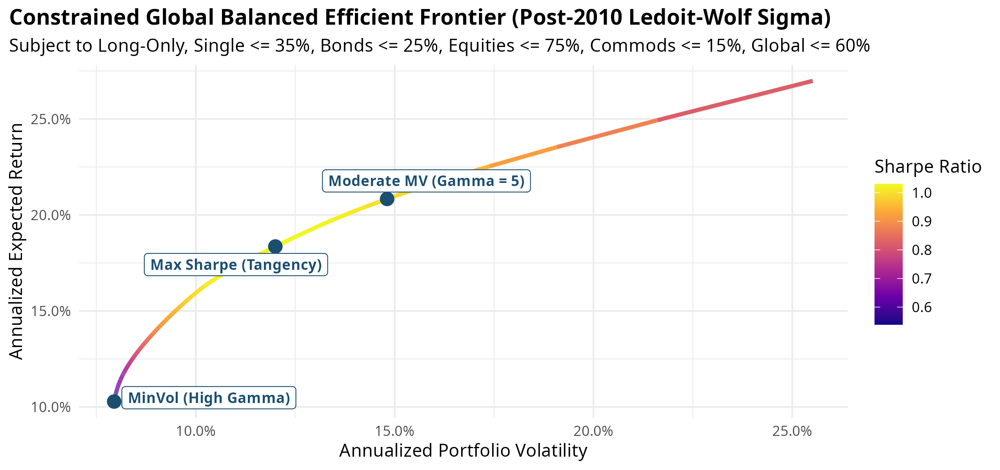
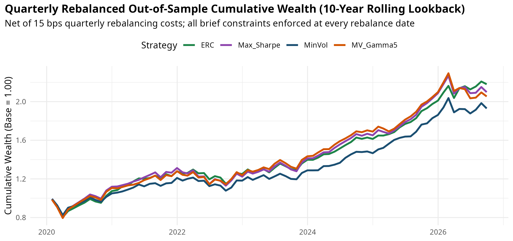
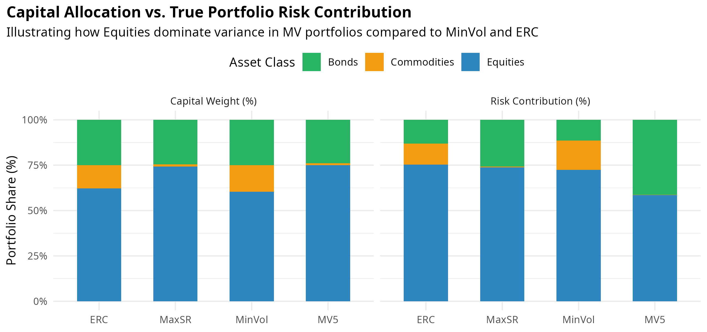

<!-- First: Set your default preferences for chunk options: -->

<!-- If you want a chunk's code to be printed, set echo = TRUE. message = FALSE stops R printing ugly package loading details in your final paper too. I also suggest setting warning = FALSE and checking for warnings in R, else you might find ugly warnings in your paper. -->

```{r setup, include=FALSE}
knitr::opts_chunk$set(echo = FALSE, message = FALSE, warning = FALSE, fig.width = 6, fig.height = 5, fig.pos="H", fig.pos = 'H', out.width = "100%")

library(tidyverse)
library(kableExtra)
list.files('./code/', full.names = T, recursive = T) %>% .[grepl('.R', .)] %>% as.list() %>% walk(~source(.))

regime_table <- readRDS("data/regime_table.rds")
oos_summary_table <- readRDS("data/oos_summary_table.rds")
risk_budget_table <- readRDS("data/risk_budget_table.rds")
static_weights_df <- readRDS("data/static_weights_df.rds")
```


<!-- ############################## -->
<!-- # Start Writing here: -->
<!-- ############################## -->

# Introduction \label{Introduction}
Constructing a Global Balanced Index Fund requires balancing long-term capital growth against downside protection while operating within strict asset-class, single-issuer, and geographic concentration limits. In accordance with the investment mandate, we design a long-only, quarterly-rebalanced portfolio optimization framework evaluated at a monthly frequency using post-2010 return data and an expanding lookback window of at least ten years ($T \ge 120$ months). To eliminate survivorship and look-ahead bias, assets with fewer than five years (60 months) of observed return history at any given rebalance date are dynamically excluded, while eligible holdings are governed by hard upper bounds on single-asset exposure ($\le 35\%$), Bonds and credit instruments ($\le 25\%$), Equities ($\le 75\%$), Commodities ($\le 15\%$), and total offshore Global exposure ($\le 60\%$).Rather than relying on a single optimization rule that may prove sensitive to estimation error in expected returns, we conduct a multi-perspective empirical horse race across four distinct construction philosophies under identical linear constraints: (i) Minimum Variance (MinVol), (ii) Moderate Mean-Variance (MV_Gamma5, $\gamma = 5$), (iii) Maximum Sharpe Ratio (Max_Sharpe), and (iv) Constrained Equal Risk Contribution (ERC). After standardizing all global and local instruments to calendar month-end returns—including synthetic 10-year constant-maturity sovereign bond Total Return Indices (TRIs) engineered from yield-to-maturity series—we evaluate both full-sample policy allocations and an out-of-sample quarterly-rebalanced backtest net of 15 bps transaction costs, supplemented by risk-budget decompositions and macro-regime stress attribution.

# Local Factor Selection
LargeCaps, MidCaps, Momentum and Value vanilla indexes was chose  o capture counter-cyclical style premia within the mandatory $\ge 40\%$ local sleeve.

# In-Sample Efficient Frontier & Policy Constraint Diagnostics
Tracing the constrained quadratic program across risk-aversion parameters $\gamma \in [2, 150]$ yields a well-behaved concave frontier spanning annualized expected returns of roughly $11\%$ to $25\%$ (Figure \ref{fig:p_frontier}). As summarized in Table \ref{tab:q4_static}, all full-sample allocations strictly respect the mandate's asset-class and geographic boundaries while revealing which limits actively bind:Geographic Binding: The 60.0% Global cap binds in MinVol, MV_Gamma5, and ERC, confirming strong optimizer demand for offshore diversification, whereas Max_Sharpe tilts 53.9% Local / 46.1% Global to capture higher nominal South African yields.Asset-Class Trade-Offs: Defensive MinVol saturates both the 25.0% Bond and 15.0% Commodity caps to dampen equity volatility, while growth-oriented MV_Gamma5 pushes Equities to the 75.0% ceiling.

```{r p_frontier, fig.cap="Efficient Frontier"}

```

```{r q4_static}
# --- TABLE 4: Combined Static Allocations (Asset Class & Region) ---
static_ac <- static_weights_df %>%
  group_by(Bucket = Asset_Class) %>%
  summarise(across(c(MinVol, Max_Sharpe, MV_Gamma5, ERC), sum), .groups = "drop")

static_reg <- static_weights_df %>%
  group_by(Bucket = Region) %>%
  summarise(across(c(MinVol, Max_Sharpe, MV_Gamma5, ERC), sum), .groups = "drop")

bind_rows(static_ac, static_reg) %>%
  mutate(across(-Bucket, ~ sprintf("%.1f%%", . * 100))) %>%
  kbl(
    caption = "Static Full-Sample Asset Class and Regional Allocations",
    col.names = c("Allocation Bucket", "MinVol", "Max_Sharpe", "MV_Gamma5", "ERC"),
    align = c("l", rep("r", 4)),
    booktabs = TRUE
  ) %>%
  pack_rows("Asset Class", 1, 3) %>%
  pack_rows("Region", 4, 5) %>%
  kable_styling(latex_options = c("striped", "hold_position"), full_width = FALSE)
```

# Out-of-Sample Rolling Backtest and Turnover Friction
Evaluating the strategies out-of-sample with quarterly rebalancing ($\ge 120$-month expanding lookback) and 15 bps transaction costs highlights a clear trade-off between return efficiency and trading friction (Table \ref{tab:q4_oos_perf} and Figure \ref{fig:p4_oos_wealth}). MV_Gamma5 delivers the strongest risk-adjusted performance with a 10.70% net annualized return and 0.376 Net Sharpe ratio, outperforming Max_Sharpe (9.84% net return; 0.327 Sharpe) because stronger variance regularization curbs sensitivity to noisy trailing sample means.However, return-seeking optimizers incur substantial implementation drag: MV_Gamma5 (20.30% quarterly turnover) and Max_Sharpe (17.80%) forfeit 6–10 bps annually to transaction costs. By contrast, ERC achieves exceptional portfolio stability (4.06% quarterly turnover, preserving 8.68% of its 8.69% gross return), while MinVol provides superior capital preservation with the lowest volatility (11.50%) and shallowest maximum drawdown (-23.80%).

```{r p4_oos_wealth, fig.cap= "oos wealth"}


```

```{r q4_oos_perf}
# Step 1: Save the raw numeric tibble first (after re-creating it)
write_rds(oos_summary_table, "data/oos_summary_table.rds")

# Step 2: Format and print without overwriting oos_summary_table
 oos_summary_table %>%
  mutate(
    across(
      c(Ann_Ret_Gross, Ann_Ret_Net, Ann_Vol, Max_Drawdown, Avg_Qtr_TO),
      ~ sprintf("%.2f%%", . * 1)
    ),
    Sharpe_Net = sprintf("%.3f", Sharpe_Net)
  ) %>%
  kbl(
    caption = "Out-of-Sample Portfolio Performance Summary (Net of 15 bps Quarterly Rebalancing Costs)",
    col.names = c("Strategy", "Gross Ret.", "Net Ret.", "Ann. Vol.", "Net Sharpe", "Max DD", "Avg. Qtr TO"),
    align = c("l", rep("r", 7)),
    booktabs = TRUE
  ) %>%
  kable_styling(latex_options = c("striped", "hold_position"), full_width = FALSE)


```


#Risk Budgeting and Macro Regime Stress Attribution
Decomposing average quarterly allocations into percentage variance contributions (Table \ref{tab:q4_risk_budget} and Figure \ref{fig:q4-risk-comp}) exposes significant risk concentration beneath seemingly balanced capital weights. Even when MinVol and ERC hold roughly 58.5%–60.3% in Equities, Equities still generate 70.4%–72.4% of total portfolio variance. More striking is the hidden duration risk inside MV_Gamma5: its 25.9% fixed-income allocation accounts for 43.2% of total portfolio risk due to heavy concentration in long-duration sovereign bonds, while its near-zero Commodity weight (1.0%) removes inflation protection.

Macro regime attribution (Table \ref{tab:q4_regimes}) confirms how these risk exposures behave under stress:

2020 COVID Shock: Sovereign bond rallies cushioned equity losses, allowing Max_Sharpe (-4.0%) and MV_Gamma5 (-4.5%) to outperform ERC (-7.4%).

2022 Inflation & Rate-Hiking Shock: Simultaneous equity and bond sell-offs punished Max_Sharpe (-6.8%), whereas ERC (-2.2%) and MinVol (-2.3%) proved far more resilient thanks to their 12.9%–14.7% Commodity sleeves, before ERC led the subsequent recovery (+141.0%).

```{r q4_risk_budget}

# --- TABLE 2: Average Weights & Risk Contributions ---
risk_budget_table %>%
  mutate(across(-Asset_Class, ~ sprintf("%.1f%%", . * 100))) %>%
  kbl(
    caption = "Average Portfolio Weights and Percentage Risk Contributions by Asset Class",
    col.names = c("Asset Class", "MinVol", "MV5", "MaxSR", "ERC", "MinVol", "MV5", "MaxSR", "ERC"),
    align = c("l", rep("r", 8)),
    booktabs = TRUE
  ) %>%
  add_header_above(c(" " = 1, "Average Weight" = 4, "Risk Contribution" = 4)) %>%
  kable_styling(latex_options = c("striped", "hold_position"), full_width = FALSE)
```

```{r q4-risk-comp, fig.cap="Risk comp"}

```


```{r q4_regimes}

# --- TABLE 3: Macro Regime Performance ---
regime_table %>%
  mutate(across(-Regime, ~ sprintf("%.2f%%", . * 100))) %>%
  kbl(
    caption = "Cumulative Strategy Returns Across Macro Regimes",
    col.names = c("Market Regime", "ERC", "MV_Gamma5", "Max_Sharpe", "MinVol"),
    align = c("l", rep("r", 4)),
    booktabs = TRUE
  ) %>%
  kable_styling(latex_options = c("striped", "hold_position"), full_width = FALSE)


```

# Conclusion
Out-of-sample testing confirms a clear trade-off between return-seeking mean-variance optimization and pure risk-based allocation: MV_Gamma5 delivers the strongest risk-adjusted growth (10.70% net annualized return and a 0.376 Net Sharpe ratio), outperforming unregularized tangency optimization (Max_Sharpe, 0.327 Net Sharpe) by curbing sensitivity to noisy sample return forecasts. Conversely, MinVol provides superior capital preservation (11.50% volatility and a -23.80% maximum drawdown), while ERC achieves exceptional portfolio stability (4.06% average quarterly turnover) and leads cumulative performance during the post-2022 recovery (+141.0%).

Furthermore, decomposing capital allocations into true variance contributions reveals that nominal policy weights can obscure underlying risk concentrations—most notably in MV_Gamma5, where a 25.9% fixed-income allocation accounts for 43.2% of portfolio risk, and where near-zero Commodity exposure leaves the fund vulnerable during inflationary rate shocks such as 2022. For an institutional mandate prioritizing Sharpe maximization, MV_Gamma5 is recommended; however, for a balanced fiduciary mandate seeking smoother drawdowns, inflation hedging, and minimal trading friction, a 50/50 strategic blend of MV_Gamma5 and ERC captures the upside of mean-variance optimization while preserving the commodity ballast and low turnover of risk parity. Future refinements could incorporate Bayes-Stein or Black-Litterman expected-return shrinkage and explicit USD/ZAR currency-hedging overlays to further stabilize offshore return attribution.


