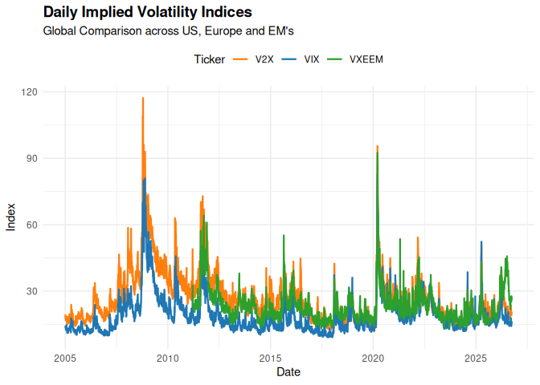
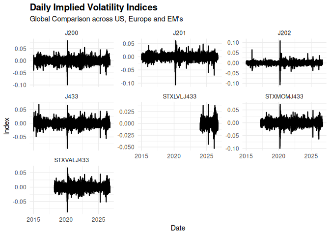
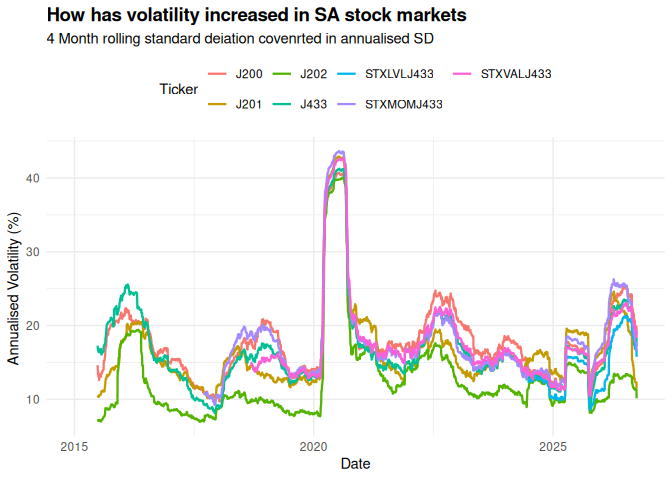
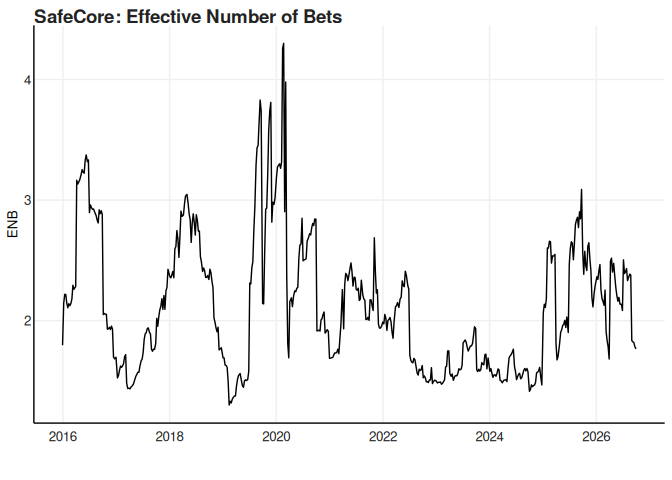
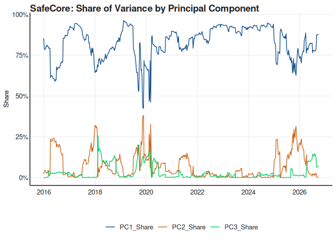
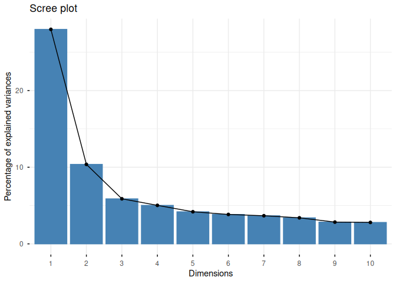
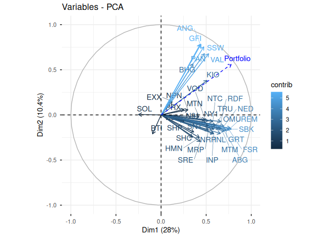
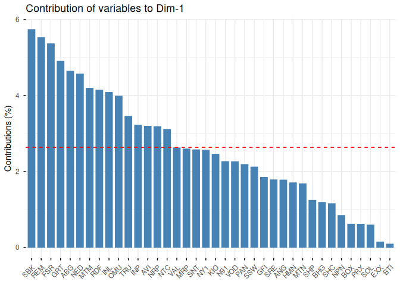
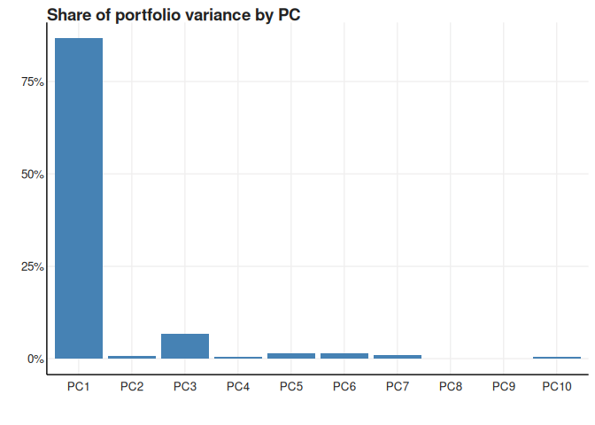

README
================
Martin Raubenheimer
2026-11-17

# Question 1

## PART A

``` r
# Economic policy uncertainty indexes:
Uncertainty_Indexes <- "data/Econ_Uncertainty_Indexes.rds" %>% read_rds()
# Implied volatility indexes:
Implied_Vol <- "data/Implied_Vol_Indexes.rds" %>% read_rds()
# Index Constituents:
Local_Index_Constituents <- "data/Index_Constituents.rds" %>% read_rds()

Idx_Daily <- read_rds("data/Index_Returns_Daily.rds")
# Currency Vol Indexes:
Local_Cncy_Vol_Index <- read_rds("data/LCL_Currency_Vol_Index.rds")
Gl_Cncy_Vol_Index <- read_rds("data/Global_Currency_Vol_Index.rds")
# Commodities:
Commods <- read_rds("data/Commodities.rds")
# MSCI
MSCI <- read_rds("data/MSCI_Indexes.rds")

## PART B
# Holdings of your firms managed portfolio:
SafeCore <- read_rds("data/SafeCore.rds")
# Factor Scores per constituent: lower values mean a lower score to the factor.
# E.g. Value of -2 means an expensive stock.
Factor_Scores <- read_rds("data/Factor_Scores.rds")

# Stock returns
Stock_returns_daily <- read_rds("data/Stock_Returns_Daily.rds")
```

### How has global volatility increased

``` r
Implied_Vol_Plot <-  Implied_Vol %>% mutate(Ticker = gsub(" Index","",Ticker)) %>% 
  
  ggplot(aes(x = date, y = TRI, color = Ticker)) +
  geom_line(linewidth = 0.8) +
  scale_color_manual(values = c(
    "VIX" = "#1f77b4", 
    "V2X" = "#ff7f0e", 
    "VXEEM" = "#2ca02c"
  )) +
  labs(
    title = "Daily Implied Volatility Indices",
    subtitle = "Global Comparison across US, Europe and EM's",
    x = "Date",
    y = "Index",
    color = "Ticker"
  ) +
  theme_minimal() +
  theme(
    plot.title = element_text(face = "bold", size = 14),
    legend.position = "top"
  )
  Implied_Vol_Plot
```

<!-- -->

Firstly we see that the three implied volatility indices move relatively
close together across the entire sample period. Secondly, there is a
spike in the begining of 2026, which was significantly larger in the EM
space than for the US and Europe. Despite the spike the inidices appears
to be relatively close to their long term average. Definitely less than
GFC to about 2013 and Covid time periods.

### Absolute returns plot

``` r
abs_return_plot <- Idx_Daily %>% 

           # Calculating absolute returns from Returns
             mutate(abs_rets = abs(Returns)) %>%
             slice(-1) %>%
    
              ggplot(aes(x = date, y = Returns)) +
              geom_line(linewidth = 0.8) +
              facet_wrap("Tickers", scales = "free_y") +
              labs(
              title = "Daily Implied Volatility Indices",
              subtitle = "Global Comparison across US, Europe and EM's",
              x = "Date",
              y = "Index",
              color = "Ticker"  ) +
              theme_minimal() +
              theme(
              plot.title = element_text(face = "bold", size = 14),
              legend.position = "top")
               
abs_return_plot
```

    ## Ignoring unknown labels:
    ## • colour : "Ticker"

<!-- -->

### Rolling SD

``` r
rolling_sd_plot <- calc_rolling_sd(Idx_Daily, n = 120, annualize = TRUE) %>% 
  
   ggplot(aes(x = date, y = annualized_vol, colour = Tickers)) +
              geom_line(linewidth = 0.8) +
              labs(
              title = "How has volatility increased in SA stock markets",
              subtitle = "4 Month rolling standard deiation covenrted in annualised SD",
              x = "Date",
              y = "Annualised Volatility (%) ",
              color = "Ticker"  ) +
              theme_minimal() +
              theme(
              plot.title = element_text(face = "bold", size = 14),
              legend.position = "top")
               
rolling_sd_plot
```

<!-- -->

``` r
          Local_Index_Constituents %>% group_by(Index)
```

    ## # A tibble: 655,336 × 6
    ## # Groups:   Index [9]
    ##    date       Tickers   Return  weight SuperSector Index 
    ##    <date>     <chr>      <dbl>   <dbl> <chr>       <chr> 
    ##  1 2020-08-31 ABG     -0.0395  0.0111  Financials  LowVol
    ##  2 2020-08-31 AGL     -0.00401 0.0409  Resources   LowVol
    ##  3 2020-08-31 ANG     -0.00756 0.0348  Resources   LowVol
    ##  4 2020-08-31 BID     -0.0318  0.0384  Industrials LowVol
    ##  5 2020-08-31 BTI      0.0191  0.00780 Industrials LowVol
    ##  6 2020-08-31 CFR      0.0199  0.0464  Industrials LowVol
    ##  7 2020-08-31 CLS     -0.0207  0.0101  Industrials LowVol
    ##  8 2020-08-31 CPI     -0.0539  0.0203  Financials  LowVol
    ##  9 2020-08-31 EXX     -0.0138  0.00468 Resources   LowVol
    ## 10 2020-08-31 FSR     -0.0473  0.0271  Financials  LowVol
    ## # ℹ 655,326 more rows

### rmgarch FOR SPILLOVERS

## Part B

### Doing PCA to obtain main sources of portfolio volatility

``` r
# Daily returns for every stock the fund has held:
 fund_tickers <- SafeCore %>% distinct(Tickers) %>% pull(Tickers)

 data_wide <-
   Stock_returns_daily %>%
   select(date, Tickers, Returns) %>%
   filter(Tickers %in% fund_tickers, date >= min(SafeCore$date)) %>%
   spread(Tickers, Returns)

# Single snapshot: weights at the latest rebalance, covariance from the 250 days ending then:
 w_date <- max(SafeCore$date)
 w <- SafeCore %>% filter(date == w_date) %>% select(Tickers, Weight) %>% tibble::deframe()
 win <- data_wide %>% filter(date <= w_date) %>% tail(250)
 rc <- Risk_Concentration(win, w, universe = "held")
 rc$port_vol * sqrt(252)   # annualised volatility (daily data)
```

    ## [1] 0.2040726

``` r
 rc$stock_rc               # which stocks drive the volatility
```

    ## # A tibble: 38 × 3
    ##    Tickers  Weight Risk_Contribution
    ##    <chr>     <dbl>             <dbl>
    ##  1 ANG     0.120              0.278 
    ##  2 GFI     0.0748             0.172 
    ##  3 VAL     0.0442             0.104 
    ##  4 MTN     0.0880             0.0630
    ##  5 SBK     0.101              0.0618
    ##  6 PAN     0.0275             0.0574
    ##  7 ABG     0.0723             0.0412
    ##  8 BHG     0.0469             0.0353
    ##  9 FSR     0.0515             0.0314
    ## 10 SSW     0.00988            0.0244
    ## # ℹ 28 more rows

``` r
 rc$pc_rc                  # which statistical factors drive the volatility
```

    ## # A tibble: 38 × 6
    ##    PC    Exposure Eigenvalue Var_Contribution     Share Cum_Share
    ##    <fct>    <dbl>      <dbl>            <dbl>     <dbl>     <dbl>
    ##  1 PC1   -0.151     0.00624      0.000143     0.867         0.867
    ##  2 PC2   -0.0238    0.00204      0.00000116   0.00700       0.874
    ##  3 PC3   -0.0886    0.00142      0.0000111    0.0674        0.941
    ##  4 PC4   -0.0304    0.000911     0.000000845  0.00511       0.946
    ##  5 PC5   -0.0613    0.000624     0.00000235   0.0142        0.961
    ##  6 PC6    0.0649    0.000525     0.00000221   0.0134        0.974
    ##  7 PC7    0.0550    0.000483     0.00000146   0.00885       0.983
    ##  8 PC8    0.0130    0.000433     0.0000000729 0.000441      0.983
    ##  9 PC9    0.00541   0.000376     0.0000000110 0.0000667     0.983
    ## 10 PC10   0.0462    0.000347     0.000000740  0.00448       0.988
    ## # ℹ 28 more rows

``` r
 rc$ENB                    # effective number of independent bets
```

    ## [1] 1.887408

``` r
# Rolling, with monthly rebalanced weights:
 roll <- Roll_Risk_Concentration(data_wide, SafeCore, lookback = 250, step = 5, n_pcs = 3)

 roll %>%
   ggplot() + geom_line(aes(date, ENB)) +
   labs(title = "SafeCore: Effective Number of Bets", x = "", y = "ENB") +
   fmxdat::theme_fmx()
```

    ## Warning in loadfonts_win(quiet = quiet): OS is not Windows. No fonts registered
    ## with windowsFonts().

    ## Warning: The `size` argument of `element_rect()` is deprecated as of ggplot2 3.4.0.
    ## ℹ Please use the `linewidth` argument instead.
    ## ℹ The deprecated feature was likely used in the fmxdat package.
    ##   Please report the issue at <https://github.com/nicktz/fmxdat/issues>.
    ## This warning is displayed once per session.
    ## Call `lifecycle::last_lifecycle_warnings()` to see where this warning was
    ## generated.

    ## Warning: The `size` argument of `element_line()` is deprecated as of ggplot2 3.4.0.
    ## ℹ Please use the `linewidth` argument instead.
    ## ℹ The deprecated feature was likely used in the fmxdat package.
    ##   Please report the issue at <https://github.com/nicktz/fmxdat/issues>.
    ## This warning is displayed once per session.
    ## Call `lifecycle::last_lifecycle_warnings()` to see where this warning was
    ## generated.

<!-- -->

``` r
 roll %>%
   pivot_longer(ends_with("_Share"), names_to = "PC", values_to = "Share") %>%
   ggplot() + geom_line(aes(date, Share, color = PC)) +
   scale_y_continuous(labels = scales::percent_format(accuracy = 1)) +
   labs(title = "SafeCore: Share of Variance by Principal Component", x = "") +
   fmxdat::theme_fmx() + fmxdat::fmx_cols()
```

    ## Warning in loadfonts_win(quiet = quiet): OS is not Windows. No fonts registered
    ## with windowsFonts().

<!-- -->

``` r
# FactoMineR / factoextra plots for the same snapshot:
 res_fm <- FM_PCA_Portfolio(win, w, scale. = TRUE, universe = "held")

 fviz_screeplot(res_fm, ncp = 10)                           # variance explained
```

<!-- -->

``` r
 fviz_pca_var(res_fm, col.var = "contrib", repel = TRUE)    # stock map; portfolio shown as supplementary
```

<!-- -->

``` r
 fviz_contrib(res_fm, choice = "var", axes = 1)             # stocks contributing most to PC1
```

<!-- -->

``` r
 res_fm$quanti.sup$cor                                       #portfolio correlation with each PC
```

    ##               Dim.1     Dim.2       Dim.3       Dim.4      Dim.5      Dim.6
    ## Portfolio 0.7801945 0.5622259 -0.06078067 -0.02954119 0.06010821 0.04950732
    ##                Dim.7      Dim.8     Dim.9     Dim.10    Dim.11      Dim.12
    ## Portfolio 0.04905409 0.01914881 0.1114817 0.06705499 0.1207743 -0.03958083
    ##              Dim.13      Dim.14     Dim.15      Dim.16     Dim.17       Dim.18
    ## Portfolio 0.0598377 -0.02570599 0.07000888 -0.01378302 0.05966824 0.0002495855
    ##                Dim.19     Dim.20    Dim.21      Dim.22     Dim.23     Dim.24
    ## Portfolio -0.05140422 0.01429376 0.0216302 0.003641053 0.03603963 0.01166002
    ##                Dim.25      Dim.26     Dim.27     Dim.28      Dim.29      Dim.30
    ## Portfolio 0.001721757 -0.03128406 0.05596765 0.01151944 -0.01179093 -0.02377604
    ##               Dim.31      Dim.32      Dim.33     Dim.34    Dim.35       Dim.36
    ## Portfolio 0.03037772 0.006684127 -0.05500167 0.04255517 0.0160517 -0.005881384
    ##                 Dim.37        Dim.38
    ## Portfolio -0.003823793 -4.982291e-06

``` r
 #The risk-share by PC from rc itself (not FactoMineR):
 rc$pc_rc %>% slice(1:10) %>%
   ggplot() + geom_col(aes(PC, Share), fill = "steelblue") +
   scale_y_continuous(labels = scales::percent_format(accuracy = 1)) +
   labs(title = "Share of portfolio variance by PC", x = "", y = "") + fmxdat::theme_fmx()
```

    ## Warning in loadfonts_win(quiet = quiet): OS is not Windows. No fonts registered
    ## with windowsFonts().

<!-- -->
