README
================
Martin Raubenheimer
2026-11-17

# Question 1

## PART A

### How has global volatility increased

``` r
Implied_Vol_Plot <-  Implied_Vol %>% mutate(Ticker = gsub(" Index","",Ticker)) %>% 
  
  ggplot(aes(x = date, y = TRI, color = Ticker)) +
  geom_line(linewidth = 0.8) +
  scale_color_manual(values = c(
    "VIX" = "#1f77b4", 
    "V2X" = "#ff7f0e", 
    "VXEEM" = "#2ca02c"
  )) +
  labs(
    title = "Daily Implied Volatility Indices",
    subtitle = "Global Comparison across US, Europe and EM's",
    x = "Date",
    y = "Index",
    color = "Ticker"
  ) +
  theme_minimal() +
  theme(
    plot.title = element_text(face = "bold", hjust = 0),
    plot.title.position = "plot",
    plot.subtitle = element_text(hjust = 0),
    legend.position = "top"
  )
  Implied_Vol_Plot
```

<!-- -->

``` r
  ggsave("figures/q1PartA/Implied_Vol_Plot.png", Implied_Vol_Plot)
```

    ## Saving 7 x 5 in image

``` r
ggsave("Questions/Question 1/Write_Up/figures/Implied_Vol_Plot.png", Implied_Vol_Plot) 
```

    ## Saving 7 x 5 in image

Firstly we see that the three implied volatility indices move relatively
close together across the entire sample period. Secondly, there is a
spike in the begining of 2026, which was significantly larger in the EM
space than for the US and Europe. Despite the spike the inidices appears
to be relatively close to their long term average. Definitely less than
GFC to about 2013 and Covid time periods.

### Absolute returns plot

``` r
abs_return_plot <- Idx_Daily %>% 

           # Calculating absolute returns from Returns
             mutate(abs_rets = abs(Returns)) %>%
             slice(-1) %>%
    
              ggplot(aes(x = date, y = Returns)) +
              geom_line(linewidth = 0.8) +
              facet_wrap("Tickers", scales = "free_y") +
              labs(
              title = "Daily Implied Volatility Indices",
              subtitle = "Global Comparison across US, Europe and EM's",
              x = "Date",
              y = "Index",
              color = "Ticker"  ) +
              theme_minimal() +
              theme(
                      plot.title = element_text(face = "bold", hjust = 0),
                      plot.title.position = "plot",
                      plot.subtitle = element_text(hjust = 0),
              legend.position = "top")
               
abs_return_plot
```

    ## Ignoring unknown labels:
    ## • colour : "Ticker"

<!-- -->

``` r
ggsave("figures/q1PartA/abs_return_plot.png", abs_return_plot)
```

    ## Saving 7 x 5 in image
    ## Ignoring unknown labels:
    ## • colour : "Ticker"

``` r
ggsave("Questions/Question 1/Write_Up/figures/abs_return_plot.png", abs_return_plot) 
```

    ## Saving 7 x 5 in image
    ## Ignoring unknown labels:
    ## • colour : "Ticker"

### Rolling SD

``` r
rolling_sd_plot <- calc_rolling_sd(Idx_Daily, n = 120, annualize = TRUE) %>% 
  
   ggplot(aes(x = date, y = annualized_vol, colour = Tickers)) +
              geom_line(linewidth = 0.8) +
              labs(
              title = "How has volatility increased in SA stock markets",
              subtitle = "4 Month rolling standard deiation converted in annualised SD",
              x = "Date",
              y = "Annualised Volatility (%) ",
              color = "Ticker"  ) +
              theme_minimal() +
                  theme(
                      plot.title = element_text(face = "bold", hjust = 0),
                      plot.title.position = "plot",
                      plot.subtitle = element_text(hjust = 0),
                      legend.position = "top"
                    )

               
rolling_sd_plot
```

<!-- -->

``` r
ggsave("figures/q1PartA/rolling_sd_plot.png", rolling_sd_plot)
```

    ## Saving 7 x 5 in image

``` r
ggsave("Questions/Question 1/Write_Up/figures/rolling_sd_plot.png", rolling_sd_plot)         
```

    ## Saving 7 x 5 in image

### rmgarch FOR SPILLOVERS

Doing GARCH between MSCI INDEXES and Capped SWIX

``` r
# DCC_GARCH data
MSCIgarch_data <-  MSCI %>% filter(Name %in% c("MSCI_USA", "MSCI_EU", "MSCI China", "MSCI_Jap"),
                               date >= "2015-01-02") %>% 
            arrange(Name, date) %>%
              group_by(Name) %>% 
                mutate( Returns = (TRI-lag(TRI))/lag(TRI),
                        Tickers = Ticker) %>% 
                    select(c(date, Returns, Name)) %>% 
                      bind_rows(Idx_Daily %>% filter(Tickers %in% "J433")) %>% 
                      group_by(Name) %>% 
                        mutate(lret = log(1+Returns)) %>%
                          select(-Tickers,Returns) %>% 
                              tbl_xts(cols_to_xts = lret, spread_by = Name) %>% na.omit

#Portanmaue test
MarchTest(MSCIgarch_data)
```

    ## Q(m) of squared series(LM test):  
    ## Test statistic:  3322.364  p-value:  0 
    ## Rank-based Test:  
    ## Test statistic:  2577.179  p-value:  0 
    ## Q_k(m) of squared series:  
    ## Test statistic:  7632.84  p-value:  0 
    ## Robust Test(5%) :  1812.748  p-value:  0

``` r
# dccPre fits the univariate GARCH models to each series in our data frame of returns.
# Let's select a VAR order of zero for the mean equation, and simply use the mean of each series.
# The mean equation is thus in our case simply: Rtn_t = mean(R) + et

# Then, for every series, a standard univariate GARCH(1,1) is run - giving us:
# et and sigmat, which is then used to calculate the standardized resids, zt, which is used in DCC calcs after.

MSCIgarch_pct <- MSCIgarch_data * 100

DCCPre <- dccPre(MSCIgarch_pct, include.mean = TRUE, p = 0)
```

    ## Sample mean of the returns:  0.01378867 0.02923117 0.03682349 0.04927219 0.0331155 
    ## Component:  1 
    ## Estimates:  0.045028 0.074993 0.906565 
    ## se.coef  :  0.011063 0.008484 0.010572 
    ## t-value  :  4.070189 8.839489 85.74883 
    ## Component:  2 
    ## Estimates:  0.040917 0.130479 0.837697 
    ## se.coef  :  0.008748 0.01634 0.020185 
    ## t-value  :  4.677183 7.985078 41.49999 
    ## Component:  3 
    ## Estimates:  0.095601 0.138255 0.795997 
    ## se.coef  :  0.024555 0.017701 0.031466 
    ## t-value  :  3.893433 7.810456 25.29689 
    ## Component:  4 
    ## Estimates:  0.039659 0.163533 0.802182 
    ## se.coef  :  0.005874 0.016828 0.017764 
    ## t-value  :  6.751741 9.718041 45.15754 
    ## Component:  5 
    ## Estimates:  0.034835 0.077237 0.893538 
    ## se.coef  :  0.011761 0.013506 0.021494 
    ## t-value  :  2.9618 5.718924 41.57056

``` r
# Making vol useabale xts
Vol <- DCCPre$marVol
colnames(Vol) <- colnames(MSCIgarch_data)
Vol_xts <- xts(Vol, order.by = index(MSCIgarch_data))
```

``` r
StdRes <- DCCPre$sresi
detach("package:tidyverse", unload=TRUE)
detach("package:tbl2xts", unload=TRUE)
```

    ## Warning: 'tbl2xts' namespace cannot be unloaded:
    ##   namespace 'tbl2xts' is imported by 'rmsfuns' so cannot be unloaded

``` r
DCC <- dccFit(StdRes, type="Engle")
```

    ## Estimates:  0.95 0.01460397 7.75434 
    ## st.errors:  0.01786868 0.003422234 0.3624788 
    ## t-values:   53.16565 4.267377 21.39253

``` r
pacman::p_load("tidyverse", "tbl2xts", "broom")
```

``` r
Rhot <- DCC$rho.t
# Right, so it gives us all the columns together in the form:
# X1,X1 ; X1,X2 ; X1,X3 ; ....

# So, let's be clever about defining more informative col names. 
# I will create a renaming function below:
ReturnSeries = MSCIgarch_data
DCC.TV.Cor = Rhot

# Let's see if our function works! Excitement!
Rhot <- 
  renamingdcc(ReturnSeries = MSCIgarch_data, DCC.TV.Cor = Rhot)

head(Rhot %>% arrange(date))
```

    ## # A tibble: 6 × 3
    ##   date       Pairs                    Rho
    ##   <date>     <chr>                  <dbl>
    ## 1 2015-01-05 MSCI.China_MSCI.China  1    
    ## 2 2015-01-05 MSCI.China_MSCI_EU     0.376
    ## 3 2015-01-05 MSCI.China_MSCI_Jap    0.316
    ## 4 2015-01-05 MSCI.China_MSCI_USA    0.278
    ## 5 2015-01-05 MSCI.China_Capped.SWIX 0.430
    ## 6 2015-01-05 MSCI_EU_MSCI.China     0.376

FINALLY THE PLOTS

``` r
g1 <- 
  ggplot(Rhot %>% filter(grepl("Capped.SWIX_", Pairs ), !grepl("_Capped.SWIX", Pairs)) ) + 
  geom_line(aes(x = date, y = Rho, colour = Pairs)) + 
  theme_hc() +
  ggtitle("Dynamic Conditional Correlations: Capped_SWIX") + 
    theme(
    plot.title = element_text(face = "bold", hjust = 0),
    plot.title.position = "plot",
    plot.subtitle = element_text(hjust = 0))

g1
```

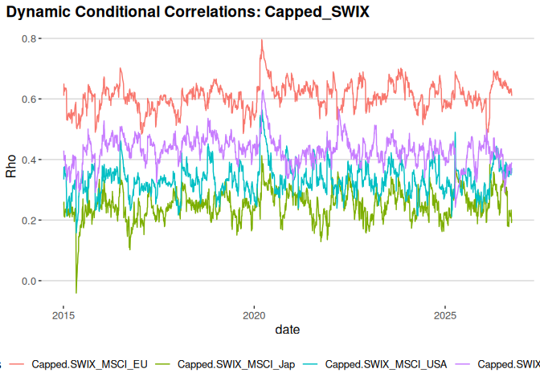<!-- -->

``` r
ggsave("figures/q1PartA/g1.png", g1)
```

    ## Saving 7 x 5 in image

``` r
ggsave("Questions/Question 1/Write_Up/figures/g1.png", g1)
```

    ## Saving 7 x 5 in image

## Part B

### Doing PCA to obtain main sources of portfolio volatility

``` r
# Daily returns for every stock the fund has held:
 fund_tickers <- SafeCore %>% distinct(Tickers) %>% pull(Tickers)

 data_wide <-
   Stock_returns_daily %>%
   select(date, Tickers, Returns) %>%
   filter(Tickers %in% fund_tickers, date >= min(SafeCore$date)) %>%
   spread(Tickers, Returns)

# Single snapshot: weights at the latest rebalance, covariance from the 250 days ending then:
 w_date <- max(SafeCore$date)
 w <- SafeCore %>% filter(date == w_date) %>% select(Tickers, Weight) %>% tibble::deframe()
 win <- data_wide %>% filter(date <= w_date) %>% tail(250)
 rc <- Risk_Concentration(win, w, universe = "held")
 rc$port_vol * sqrt(252)   # annualised volatility (daily data)
```

    ## [1] 0.2040726

``` r
 rc$stock_rc               # which stocks drive the volatility
```

    ## # A tibble: 38 × 3
    ##    Tickers  Weight Risk_Contribution
    ##    <chr>     <dbl>             <dbl>
    ##  1 ANG     0.120              0.278 
    ##  2 GFI     0.0748             0.172 
    ##  3 VAL     0.0442             0.104 
    ##  4 MTN     0.0880             0.0630
    ##  5 SBK     0.101              0.0618
    ##  6 PAN     0.0275             0.0574
    ##  7 ABG     0.0723             0.0412
    ##  8 BHG     0.0469             0.0353
    ##  9 FSR     0.0515             0.0314
    ## 10 SSW     0.00988            0.0244
    ## # ℹ 28 more rows

``` r
 rc$pc_rc                  # which statistical factors drive the volatility
```

    ## # A tibble: 38 × 6
    ##    PC    Exposure Eigenvalue Var_Contribution     Share Cum_Share
    ##    <fct>    <dbl>      <dbl>            <dbl>     <dbl>     <dbl>
    ##  1 PC1   -0.151     0.00624      0.000143     0.867         0.867
    ##  2 PC2   -0.0238    0.00204      0.00000116   0.00700       0.874
    ##  3 PC3   -0.0886    0.00142      0.0000111    0.0674        0.941
    ##  4 PC4   -0.0304    0.000911     0.000000845  0.00511       0.946
    ##  5 PC5   -0.0613    0.000624     0.00000235   0.0142        0.961
    ##  6 PC6    0.0649    0.000525     0.00000221   0.0134        0.974
    ##  7 PC7    0.0550    0.000483     0.00000146   0.00885       0.983
    ##  8 PC8    0.0130    0.000433     0.0000000729 0.000441      0.983
    ##  9 PC9    0.00541   0.000376     0.0000000110 0.0000667     0.983
    ## 10 PC10   0.0462    0.000347     0.000000740  0.00448       0.988
    ## # ℹ 28 more rows

``` r
 rc$ENB                    # effective number of independent bets
```

    ## [1] 1.887408

``` r
# Rolling, with monthly rebalanced weights:
 roll <- Roll_Risk_Concentration(data_wide, SafeCore, lookback = 250, step = 5, n_pcs = 3)

SafeCore_eff_num_bets <-  roll %>%
   ggplot() + geom_line(aes(date, ENB)) +
   labs(title = "SafeCore: Effective Number of Bets", x = "", y = "ENB") +
   fmxdat::theme_fmx() +  theme(plot.title = element_text(face = "bold", hjust = 0),
                      plot.title.position = "plot",
                      plot.subtitle = element_text(hjust = 0))
```

    ## Warning in loadfonts_win(quiet = quiet): OS is not Windows. No fonts registered
    ## with windowsFonts().

    ## Warning: The `size` argument of `element_rect()` is deprecated as of ggplot2 3.4.0.
    ## ℹ Please use the `linewidth` argument instead.
    ## ℹ The deprecated feature was likely used in the fmxdat package.
    ##   Please report the issue at <https://github.com/nicktz/fmxdat/issues>.
    ## This warning is displayed once per session.
    ## Call `lifecycle::last_lifecycle_warnings()` to see where this warning was
    ## generated.

    ## Warning: The `size` argument of `element_line()` is deprecated as of ggplot2 3.4.0.
    ## ℹ Please use the `linewidth` argument instead.
    ## ℹ The deprecated feature was likely used in the fmxdat package.
    ##   Please report the issue at <https://github.com/nicktz/fmxdat/issues>.
    ## This warning is displayed once per session.
    ## Call `lifecycle::last_lifecycle_warnings()` to see where this warning was
    ## generated.

``` r
SafeCore_eff_num_bets
```

<!-- -->

``` r
ggsave("figures/q1partB/SafeCore_eff_num_bets.png", SafeCore_eff_num_bets)
```

    ## Saving 7 x 5 in image

``` r
ggsave("Questions/Question 1/Write_Up/figures/SafeCore_eff_num_bets.png", SafeCore_eff_num_bets)
```

    ## Saving 7 x 5 in image

``` r
prop_var <-  roll %>%
   pivot_longer(ends_with("_Share"), names_to = "PC", values_to = "Share") %>%
   ggplot() + geom_line(aes(date, Share, color = PC)) +
   scale_y_continuous(labels = scales::percent_format(accuracy = 1)) +
   labs(title = "SafeCore: Share of Variance by Principal Component", x = "") +
   fmxdat::theme_fmx() + fmxdat::fmx_cols()
```

    ## Warning in loadfonts_win(quiet = quiet): OS is not Windows. No fonts registered
    ## with windowsFonts().

``` r
prop_var
```

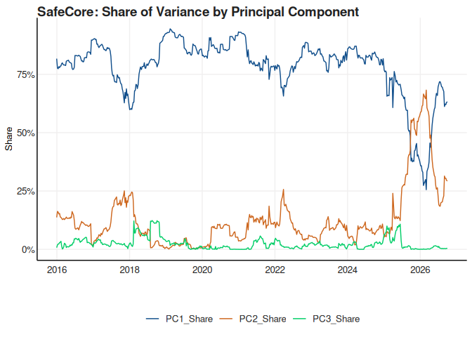<!-- -->

``` r
ggsave("figures/q1partB/prop_var.png", prop_var)
```

    ## Saving 7 x 5 in image

``` r
ggsave("Questions/Question 1/Write_Up/figures/prop_var.png", prop_var)
```

    ## Saving 7 x 5 in image

``` r
# FactoMineR / factoextra plots for the same snapshot:
 res_fm <- FM_PCA_Portfolio(win, w, scale. = TRUE, universe = "held")

 scree_plot <- fviz_screeplot(res_fm, ncp = 10)                           # variance explained
  ggsave("figures/q1partB/screeplot.png", plot = scree_plot , width = 8, height = 5, dpi = 300)
  scree_plot
```

<!-- -->

``` r
stock_map <-  fviz_pca_var(res_fm, col.var = "contrib", repel = TRUE)    # stock map; portfolio shown as supplementary
  ggsave("figures/q1partB/stock_map.png", plot = stock_map , width = 8, height = 5, dpi = 300)
  stock_map
```

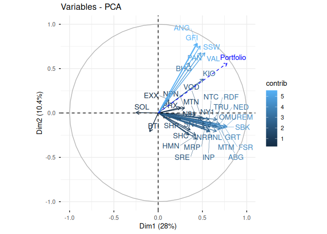<!-- -->

``` r
 stock_contrib <- fviz_contrib(res_fm, choice = "var", axes = 1)             # stocks contributing most to PC1
 stock_contrib
```

<!-- -->

``` r
 ggsave("figures/q1partB/stock_contrib.png", plot = stock_contrib , width = 8, height = 5, dpi = 300)
 
 res_fm$quanti.sup$cor                                       #portfolio correlation with each PC
```

    ##               Dim.1     Dim.2       Dim.3       Dim.4      Dim.5      Dim.6
    ## Portfolio 0.7801945 0.5622259 -0.06078067 -0.02954119 0.06010821 0.04950732
    ##                Dim.7      Dim.8     Dim.9     Dim.10    Dim.11      Dim.12
    ## Portfolio 0.04905409 0.01914881 0.1114817 0.06705499 0.1207743 -0.03958083
    ##              Dim.13      Dim.14     Dim.15      Dim.16     Dim.17       Dim.18
    ## Portfolio 0.0598377 -0.02570599 0.07000888 -0.01378302 0.05966824 0.0002495855
    ##                Dim.19     Dim.20    Dim.21      Dim.22     Dim.23     Dim.24
    ## Portfolio -0.05140422 0.01429376 0.0216302 0.003641053 0.03603963 0.01166002
    ##                Dim.25      Dim.26     Dim.27     Dim.28      Dim.29      Dim.30
    ## Portfolio 0.001721757 -0.03128406 0.05596765 0.01151944 -0.01179093 -0.02377604
    ##               Dim.31      Dim.32      Dim.33     Dim.34    Dim.35       Dim.36
    ## Portfolio 0.03037772 0.006684127 -0.05500167 0.04255517 0.0160517 -0.005881384
    ##                 Dim.37        Dim.38
    ## Portfolio -0.003823793 -4.982291e-06

``` r
 write.csv(res_fm$quanti.sup$cor, "data/portfolio_pc_correlations.csv")
 

 #The risk-share by PC from rc itself (not FactoMineR):
share_port_var_pc <-  rc$pc_rc %>% slice(1:10) %>%
   ggplot() + geom_col(aes(PC, Share), fill = "steelblue") +
   scale_y_continuous(labels = scales::percent_format(accuracy = 1)) +
   labs(title = "Share of portfolio variance by PC", x = "", y = "") + fmxdat::theme_fmx()
```

    ## Warning in loadfonts_win(quiet = quiet): OS is not Windows. No fonts registered
    ## with windowsFonts().

``` r
ggsave("figures/q1partB/share_port_var_pc.png", plot = share_port_var_pc, width = 8, height = 5, dpi = 300)
```

### Did SafeCore navigate volatility well?

Creating Fin stats table to analyse how well safe core handled
volatility

``` r
# Envisaged parameters:

BM <- "Bench"
Yrs_LookBack <- 5
NA_Check <- 0.8  # atleast 80% of obs not-NA.
```

``` r
pacman::p_load("tidyverse", "lubridate", "tbl2xts", "PerformanceAnalytics", "rmsfuns")

ann <- 252     # trading days per year

# ---------------------------------------------------------------
# 1. Benchmark: Capped SWIX (J433) daily returns
# ---------------------------------------------------------------
# Check the ticker label in your index file:
Bench_returns <-
  Idx_Daily %>%
  filter(Tickers == "J433") %>%
  arrange(date) %>%
  mutate(Mkt = Returns) %>%
  filter(!is.na(Mkt)) %>%
  select(date, Mkt)
# ---------------------------------------------------------------
# 2. Daily stock returns, wide (dates x stocks), for stocks the fund has held
# ---------------------------------------------------------------
fund_tickers <- SafeCore %>% distinct(Tickers) %>% pull(Tickers)

R_xts <-
  Stock_returns_daily %>%
  filter(Tickers %in% fund_tickers) %>%
  select(date, Tickers, Returns) %>%
  tbl_xts(cols_to_xts = Returns, spread_by = Tickers)

# No return recorded (e.g. suspended / not yet listed) = 0 return:
R_xts[is.na(R_xts)] <- 0


# ---------------------------------------------------------------
# 3. Monthly weights, wide, stamped with the first trading day they apply
# ---------------------------------------------------------------
# Safe_Return.portfolio makes weights effective on the date they are stamped. SafeCore's
# weights are set at the month-end close, so stamp them with the NEXT trading day:
trading_days <- index(R_xts)

reb <-
  SafeCore %>%
  distinct(date) %>%
  mutate(idx = findInterval(as.numeric(date), as.numeric(trading_days)),   # last trading day on or before
         trade_date = trading_days[idx + 1]) %>%                            # next trading day (NA if none)
  filter(!is.na(trade_date)) %>%
  select(date, trade_date)

W_xts <-
  SafeCore %>%
  inner_join(reb, by = "date") %>%
  select(date = trade_date, Tickers, Weight) %>%
  tbl_xts(cols_to_xts = Weight, spread_by = Tickers)

# A stock the fund does not hold in a given month has weight 0 (not NA):
W_xts[is.na(W_xts)] <- 0

# Same stocks, same column order in both objects (Safe_Return.portfolio requires this):
common <- intersect(colnames(R_xts), colnames(W_xts))
R_xts <- R_xts[, common]
W_xts <- W_xts[, common]

# Each row sums to 1 (also guards against weights stored in percent):
W_xts <- W_xts / rowSums(W_xts)

# ---------------------------------------------------------------
# 4. SafeCore daily returns: weights set at each rebalance, then left to drift
# ---------------------------------------------------------------
Fund_ret <-
  rmsfuns::Safe_Return.portfolio(R = R_xts[index(R_xts) >= min(index(W_xts)), ],
                                 weights = W_xts,
                                 lag_weights = TRUE,
                                 geometric = TRUE) %>%
  xts_tbl() %>%
  rename(Returns = portfolio.returns) %>%
  mutate(Tickers = "SafeCore")

Stats_data <-
  bind_rows(Fund_ret,
            Bench_returns %>%
              filter(date >= min(Fund_ret$date)) %>%
              transmute(date, Tickers = "Capped_SWIX", Returns = Mkt)) %>%
  select(date, Tickers, Returns)

# Wide xts, common dates only:
Ret_xts <- Stats_data %>% tbl_xts(cols_to_xts = Returns, spread_by = Tickers) %>% na.omit()

# Quick checks:
# range(rowSums(W_xts))                                    # should be 1
# Stats_data %>% group_by(Tickers) %>% summarise(n = n(), first = min(date), last = max(date))

# ---------------------------------------------------------------
# 5. Financial statistics table
# ---------------------------------------------------------------
stat_col <- function(r) {
  c("Annualised Return (%)"          = as.numeric(Return.annualized(r, scale = ann, geometric = TRUE)) * 100,
    "Annualised Volatility (%)"      = as.numeric(StdDev.annualized(r, scale = ann)) * 100,
    "Return / Volatility"            = as.numeric(Return.annualized(r, scale = ann, geometric = TRUE)) /
                                       as.numeric(StdDev.annualized(r, scale = ann)),   # risk-free rate ignored
    "Skewness"                       = as.numeric(skewness(r)),
    "Excess Kurtosis"                = as.numeric(kurtosis(r, method = "excess")),
    "Max Drawdown (%)"               = -as.numeric(maxDrawdown(r, geometric = TRUE)) * 100,
    "Downside Deviation (%, ann.)"   = as.numeric(DownsideDeviation(r, MAR = 0)) * sqrt(ann) * 100,
    "Worst Day (%)"                  = min(as.numeric(r)) * 100,
    "Positive Days (%)"              = mean(as.numeric(r) > 0) * 100)
}

Stats_tbl <-
  sapply(colnames(Ret_xts), function(n) stat_col(Ret_xts[, n])) %>%
  as_tibble(rownames = "Metric")

# Fund relative to the Capped SWIX (shown for SafeCore only):
f <- as.numeric(Ret_xts[, "SafeCore"])
b <- as.numeric(Ret_xts[, "Capped_SWIX"])

Relative_tbl <-
  tibble(Metric = c("Beta to Capped SWIX",
                    "Tracking Error (%, ann.)",
                    "Information Ratio",
                    "Up Capture (%)",
                    "Down Capture (%)"),
         SafeCore = c(as.numeric(CAPM.beta(Ra = Ret_xts[, "SafeCore"], Rb = Ret_xts[, "Capped_SWIX"])),
                      as.numeric(TrackingError(Ret_xts[, "SafeCore"], Ret_xts[, "Capped_SWIX"], scale = ann)) * 100,
                      as.numeric(InformationRatio(Ret_xts[, "SafeCore"], Ret_xts[, "Capped_SWIX"], scale = ann)),
                      mean(f[b > 0]) / mean(b[b > 0]) * 100,      # average fund return / benchmark return on up days
                      mean(f[b < 0]) / mean(b[b < 0]) * 100))     # same on down days (<100 = loses less)

Final_tbl <- bind_rows(Stats_tbl, Relative_tbl)

options(knitr.kable.NA = "")
kable(Final_tbl,
      digits = 2,
      align = "lrr",
      caption = paste0("SafeCore vs Capped SWIX: ", min(index(Ret_xts)), " to ", max(index(Ret_xts)),
                       " (daily data, annualised with ", ann, " days)"))
```

| Metric                       | SafeCore | Capped_SWIX |
|:-----------------------------|---------:|------------:|
| Annualised Return (%)        |    10.75 |        8.65 |
| Annualised Volatility (%)    |    17.84 |       17.84 |
| Return / Volatility          |     0.60 |        0.49 |
| Skewness                     |    -0.41 |       -0.44 |
| Excess Kurtosis              |     4.94 |        6.72 |
| Max Drawdown (%)             |   -38.99 |      -41.66 |
| Downside Deviation (%, ann.) |    12.56 |       12.65 |
| Worst Day (%)                |    -8.67 |       -9.17 |
| Positive Days (%)            |    52.13 |       52.06 |
| Beta to Capped SWIX          |     0.95 |             |
| Tracking Error (%, ann.)     |     5.66 |             |
| Information Ratio            |     0.37 |             |
| Up Capture (%)               |    99.13 |             |
| Down Capture (%)             |    97.04 |             |

SafeCore vs Capped SWIX: 2015-01-02 to 2026-09-30 (daily data,
annualised with 252 days)

### Where does volatility come from

Stock-level and sector-level contributions to portfolio variance at the
latest rebalance (covariance from the 250 days ending then).

``` r
# Needs: rc, w_date, SafeCore (from the Part B chunks above)
Stock_RC <-
  rc$stock_rc %>%
  mutate(Weight = Weight / sum(Weight)) %>%               # make sure weights sum to 1
  left_join(SafeCore %>% filter(date == w_date) %>% select(Tickers, Sector), by = "Tickers") %>%
  mutate(Beta_to_Port = Risk_Contribution / Weight)       # >1 adds to concentration, <1 diversifies

# Top 10 risk contributors:
Stock_RC %>%
  slice_max(Risk_Contribution, n = 10) %>%
  select(Tickers, Sector, Weight, Risk_Contribution, Beta_to_Port) %>%
  mutate(across(c(Weight, Risk_Contribution), ~ .x * 100)) %>%
  knitr::kable(digits = 2,
               col.names = c("Stock", "Sector", "Weight (%)", "Risk contribution (%)", "Beta to portfolio"))
```

| Stock | Sector      | Weight (%) | Risk contribution (%) | Beta to portfolio |
|:------|:------------|-----------:|----------------------:|------------------:|
| ANG   | Resources   |      11.97 |                 27.76 |              2.32 |
| GFI   | Resources   |       7.48 |                 17.25 |              2.31 |
| VAL   |             |       4.42 |                 10.41 |              2.36 |
| MTN   | Industrials |       8.80 |                  6.30 |              0.72 |
| SBK   | Financials  |      10.13 |                  6.18 |              0.61 |
| PAN   |             |       2.75 |                  5.74 |              2.09 |
| ABG   | Financials  |       7.23 |                  4.12 |              0.57 |
| BHG   | Resources   |       4.69 |                  3.53 |              0.75 |
| FSR   | Financials  |       5.15 |                  3.14 |              0.61 |
| SSW   | Resources   |       0.99 |                  2.44 |              2.47 |

``` r
# Weight vs share of risk, top 15 risk contributors:
Stock_RC %>%
  slice_max(Risk_Contribution, n = 15) %>%
  select(Tickers, Weight, Risk_Contribution) %>%
  pivot_longer(-Tickers, names_to = "Measure", values_to = "Share") %>%
  mutate(Tickers = fct_reorder(Tickers, Share, .fun = max)) %>%
  ggplot(aes(Tickers, Share, fill = Measure)) +
  geom_col(position = "dodge") +
  coord_flip() +
  scale_y_continuous(labels = scales::percent_format(accuracy = 1)) +
  labs(title = "SafeCore: weight vs share of portfolio variance", x = "", y = "") +
  fmxdat::theme_fmx() + fmxdat::fmx_fills()
```

    ## Warning in loadfonts_win(quiet = quiet): OS is not Windows. No fonts registered
    ## with windowsFonts().

<!-- -->

``` r
# Sector view:
Sector_RC <-
  Stock_RC %>%
  group_by(Sector) %>%
  summarise(Weight = sum(Weight), Risk_Contribution = sum(Risk_Contribution), .groups = "drop") %>%
  mutate(Risk_to_Weight = Risk_Contribution / Weight) %>%    # >1 = sector contributes more risk than its size
  arrange(desc(Risk_Contribution))

Sector_RC %>%
  mutate(across(c(Weight, Risk_Contribution), ~ .x * 100)) %>%
  knitr::kable(digits = 2,
               col.names = c("Sector", "Weight (%)", "Risk contribution (%)", "Risk / weight"))
```

| Sector      | Weight (%) | Risk contribution (%) | Risk / weight |
|:------------|-----------:|----------------------:|--------------:|
| Resources   |      32.98 |                 52.01 |          1.58 |
| Financials  |      31.34 |                 17.73 |          0.57 |
|             |       7.17 |                 16.15 |          2.25 |
| Industrials |      25.98 |                 13.25 |          0.51 |
| Property    |       2.53 |                  0.86 |          0.34 |

### Diversifiers and concentrators

A stock’s risk contribution divided by its weight equals its beta to the
portfolio. Stocks below 1 reduce concentration relative to their size.
Very small positions are excluded so they do not dominate the ranking.

``` r
min_weight <- 0.005    # ignore positions below 0.5%

Stock_RC %>%
  filter(Weight >= min_weight) %>%
  arrange(Beta_to_Port) %>%
  slice(c(1:10, (n() - 9):n())) %>%
  mutate(Type = ifelse(Beta_to_Port < 1, "Diversifier", "Concentrator"),
         Weight = Weight * 100, Risk_Contribution = Risk_Contribution * 100) %>%
  select(Type, Tickers, Sector, Weight, Risk_Contribution, Beta_to_Port) %>%
  knitr::kable(digits = 2,
               col.names = c("", "Stock", "Sector", "Weight (%)", "Risk contribution (%)", "Beta to portfolio"))
```

|  | Stock | Sector | Weight (%) | Risk contribution (%) | Beta to portfolio |
|:---|:---|:---|---:|---:|---:|
| Diversifier | BTI | Industrials | 0.81 | -0.13 | -0.16 |
| Diversifier | SOL | Resources | 4.84 | -0.52 | -0.11 |
| Diversifier | SHP | Industrials | 2.06 | 0.41 | 0.20 |
| Diversifier | NRP | Property | 1.07 | 0.25 | 0.23 |
| Diversifier | EXX | Resources | 1.68 | 0.44 | 0.26 |
| Diversifier | AVI | Industrials | 0.99 | 0.34 | 0.35 |
| Diversifier | PRX | Industrials | 1.35 | 0.51 | 0.37 |
| Diversifier | INL | Financials | 0.58 | 0.24 | 0.41 |
| Diversifier | VOD | Industrials | 2.78 | 1.17 | 0.42 |
| Diversifier | NTC | Industrials | 0.52 | 0.22 | 0.43 |
| Diversifier | SBK | Financials | 10.13 | 6.18 | 0.61 |
| Diversifier | FSR | Financials | 5.15 | 3.14 | 0.61 |
| Diversifier | MTN | Industrials | 8.80 | 6.30 | 0.72 |
| Diversifier | BHG | Resources | 4.69 | 3.53 | 0.75 |
| Diversifier | KIO | Resources | 1.34 | 1.12 | 0.84 |
| Concentrator | PAN |  | 2.75 | 5.74 | 2.09 |
| Concentrator | GFI | Resources | 7.48 | 17.25 | 2.31 |
| Concentrator | ANG | Resources | 11.97 | 27.76 | 2.32 |
| Concentrator | VAL |  | 4.42 | 10.41 | 2.36 |
| Concentrator | SSW | Resources | 0.99 | 2.44 | 2.47 |

### Rolling volatility: SafeCore vs Capped SWIX

``` r
# Needs: Ret_xts (from the financial statistics chunk above)
roll_vol <-
  zoo::rollapplyr(zoo::coredata(Ret_xts), width = 250, FUN = sd, by.column = TRUE, fill = NA) * sqrt(252) * 100

roll_vol %>%
  as_tibble() %>%
  mutate(date = index(Ret_xts)) %>%
  pivot_longer(-date, names_to = "Series", values_to = "Vol") %>%
  na.omit() %>%
  ggplot() +
  geom_line(aes(date, Vol, color = Series), linewidth = 0.8) +
  labs(title = "Rolling 250-day annualised volatility", x = "", y = "Annualised volatility (%)") +
  fmxdat::theme_fmx() + fmxdat::fmx_cols()
```

    ## Warning in loadfonts_win(quiet = quiet): OS is not Windows. No fonts registered
    ## with windowsFonts().

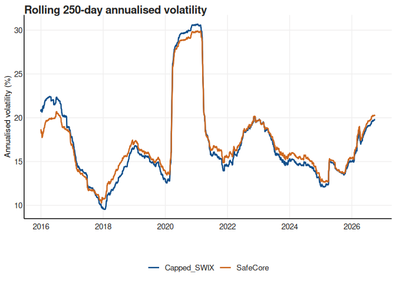<!-- -->

### How did SafeCore behave when volatility was high?

``` r
Monthly <-
  Ret_xts %>%
  xts_tbl() %>%
  mutate(ym = floor_date(date, "month")) %>%
  group_by(ym) %>%
  summarise(across(c(SafeCore, Capped_SWIX), ~ prod(1 + .x) - 1), .groups = "drop")

# (a) The benchmark's worst 10% of months:
Monthly %>%
  mutate(Regime = ifelse(Capped_SWIX <= quantile(Capped_SWIX, 0.1), "Worst 10% of benchmark months", "Other months")) %>%
  group_by(Regime) %>%
  summarise(Months = n(), SafeCore = mean(SafeCore) * 100, Capped_SWIX = mean(Capped_SWIX) * 100,
            Difference = SafeCore - Capped_SWIX, .groups = "drop") %>%
  knitr::kable(digits = 2, caption = "Average monthly return (%)")
```

| Regime                        | Months | SafeCore | Capped_SWIX | Difference |
|:------------------------------|-------:|---------:|------------:|-----------:|
| Other months                  |    126 |     1.75 |        1.73 |       0.01 |
| Worst 10% of benchmark months |     15 |    -5.89 |       -7.16 |       1.27 |

Average monthly return (%)

``` r
# (b) Months of high global implied volatility (top quartile of the VIX; links back to Part A):
VIX_monthly <-
  Implied_Vol %>%
  mutate(Ticker = gsub(" Index", "", Ticker)) %>%
  filter(Ticker == "VIX") %>%
  mutate(ym = floor_date(date, "month")) %>%
  group_by(ym) %>%
  summarise(VIX = mean(TRI), .groups = "drop")

Monthly %>%
  left_join(VIX_monthly, by = "ym") %>%
  filter(!is.na(VIX)) %>%
  mutate(Regime = ifelse(VIX >= quantile(VIX, 0.75), "High global vol (top quartile VIX)", "Other months")) %>%
  group_by(Regime) %>%
  summarise(Months = n(), SafeCore = mean(SafeCore) * 100, Capped_SWIX = mean(Capped_SWIX) * 100,
            Difference = SafeCore - Capped_SWIX, .groups = "drop") %>%
  knitr::kable(digits = 2, caption = "Average monthly return (%)")
```

| Regime                             | Months | SafeCore | Capped_SWIX | Difference |
|:-----------------------------------|-------:|---------:|------------:|-----------:|
| High global vol (top quartile VIX) |     36 |     0.93 |        0.84 |       0.08 |
| Other months                       |    105 |     0.94 |        0.77 |       0.17 |

Average monthly return (%)

## Part C

### Chart 1 (Dispersion):

``` r
# Data
csv_df   <- calc_cross_sectional_metrics(Local_Index_Constituents, window = 120)
cor_df   <- calc_rolling_correlations(Local_Index_Constituents, window = 60)
idio_df  <- calc_idiosyncratic_metrics(Local_Index_Constituents, Idx_Daily, benchmark_ticker = "J433")
macro_df <- prepare_macro_factors(Uncertainty_Indexes, Gl_Cncy_Vol_Index)

# Master dataset from 2020 onwards
alpha_master_df <- list(csv_df, cor_df, idio_df, macro_df) %>%
  purrr::map(~ mutate(.x, date = as.Date(date))) %>%
  purrr::reduce(dplyr::left_join, by = "date")
```

Weighted CSV since 2020 (annotated with major events: COVID crash, 2022
global rate hikes, local election/rate cycles), with a brief comparison
to unweighted CSV.

``` r
csv_dispersion_plot <- plot_csv_dispersion(alpha_master_df)
csv_dispersion_plot
```

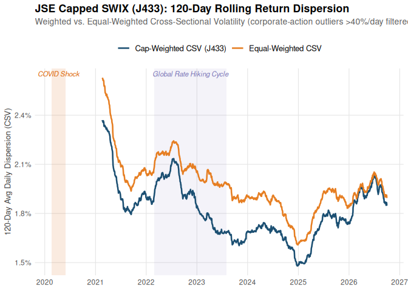<!-- -->

``` r
ggsave("figures/csv_dispersion_plot.png", csv_dispersion_plot)
```

    ## Saving 7 x 5 in image

Chart 2 (Correlation Regime): Rolling 60-day median pairwise
correlation + interquartile ribbon (or Rolling PCA 1st component
variance explained / Sector DCC-GARCH).

``` r
correlation_regimes_plot <- plot_correlation_regimes(alpha_master_df)
correlation_regimes_plot
```

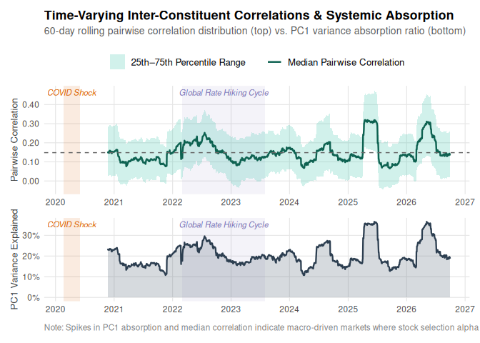<!-- -->

``` r
ggsave("figures/correlation_regimes_plot.png", correlation_regimes_plot)
```

    ## Saving 7 x 5 in image

Chart 3 (The “Alpha Opportunity Matrix”): Plot CSV against Rolling
Correlation. Highlight quadrants (e.g., High CSV + Low Correlation =
Peak Stock-Picker’s Market).

``` r
alpha_quadrant_plot <- plot_alpha_quadrant(alpha_master_df)
alpha_quadrant_plot
```

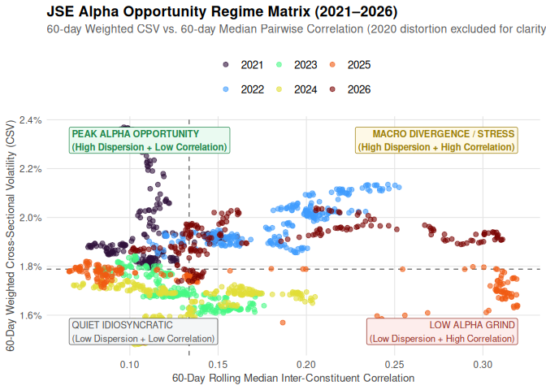<!-- -->

``` r
ggsave("figures/alpha_quadrant_plot.png", alpha_quadrant_plot)
```

    ## Saving 7 x 5 in image

Chart 4 / Table (Macro Drivers): Overlay CSV and Rolling Correlation
with 2–3 key macro series (e.g., VIX, US 10Y Yield, USD/ZAR) and compute
rolling correlations or regime averages (e.g., 2020–2021 ZIRP era
vs. 2022–2023 Hiking era vs. 2024–2026 Normalization).

``` r
macro_drivers_plot<- plot_macro_drivers(alpha_master_df)
macro_drivers_plot
```

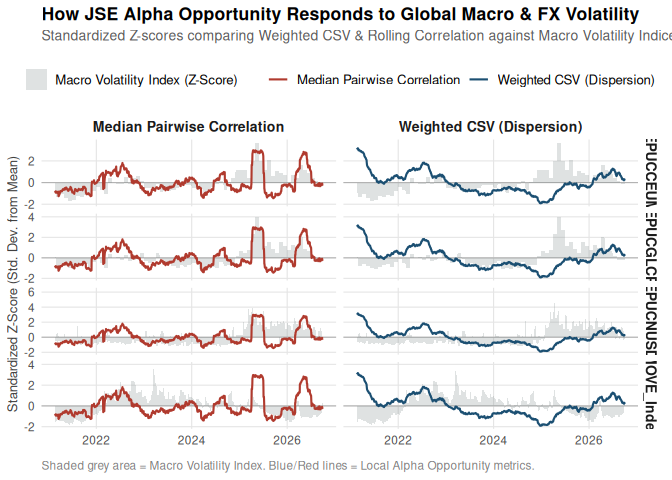<!-- -->

``` r
ggsave("figures/macro_drivers_plot.png", macro_drivers_plot)
```

    ## Saving 7 x 5 in image

# Question 2

``` r
glimpse(Size_Idx); glimpse(Stock_returns_daily)
```

    ## Rows: 70,946
    ## Columns: 5
    ## $ date    <date> 2007-01-31, 2007-01-31, 2007-01-31, 2007-01-31, 2007-01-31, 2…
    ## $ Tickers <chr> "ACP", "ADR", "ADH", "AFE", "AFO", "AFR", "AFX", "ARI", "ALT",…
    ## $ Sector  <chr> "Property", NA, "Industrials", "Resources", NA, "Industrials",…
    ## $ Weight  <dbl> 0.0008977529, 0.0005191705, 0.0004830278, 0.0035199822, 0.0001…
    ## $ Fund    <chr> "CappedSWIX", "CappedSWIX", "CappedSWIX", "CappedSWIX", "Cappe…

    ## Rows: 574,774
    ## Columns: 4
    ## $ date    <date> 2015-01-02, 2015-01-05, 2015-01-06, 2015-01-07, 2015-01-08, 2…
    ## $ Returns <dbl> -0.011593407, -0.034131970, 0.026071942, 0.020866053, 0.025824…
    ## $ Tickers <chr> "ABG", "ABG", "ABG", "ABG", "ABG", "ABG", "ABG", "ABG", "ABG",…
    ## $ Name    <chr> "ABSA GROUP LTD", "ABSA GROUP LTD", "ABSA GROUP LTD", "ABSA GR…

``` r
Size_Idx %>% distinct(Fund) %>% print()  
```

    ## # A tibble: 4 × 1
    ##   Fund      
    ##   <chr>     
    ## 1 CappedSWIX
    ## 2 MidCaps   
    ## 3 SmallCaps 
    ## 4 LargeCaps

``` r
bench      <- "CappedSWIX"   
idx_levels <- c("LargeCaps", "MidCaps", "SmallCaps")  
cons <- prep_constituents(Size_Idx) %>% 
  mutate(Sector = replace_na(Sector, "Unclassified"))#,
         #Sector = ifelse(Index == "LargeCaps" & Sector == "Unclassified", drop_na(Sector), Sector))

panel   <- build_stock_panel(cons, Stock_returns_daily)
idx_ret <- build_index_returns(panel) %>% filter(Index %in% c(idx_levels, "CappedSWIX"))
```

``` r
# Sector-stratified returns inside each index (sector sub-portfolios)
sector_ret <- build_index_returns(panel %>% filter(Index %in% idx_levels),
                                  by = c("Index", "Sector"))

sector_cols <- c(Financials = "#1b9e77", Industrials = "#d95f02", Property = "#7570b3",
                 Resources = "#e6ab02", Unclassified = "grey70")

idx_order <- c("CappedSWIX", "LargeCaps", "MidCaps", "SmallCaps")

## Calculating and Plotting sector weights
sw <- sector_weights(cons= cons)

plots <- idx_order %>%
  imap(\(i, k) plot_sector_weights(sw, i, show_y = k %in% c(1, 3)))

sector_exposure_plot <-
  wrap_plots(plots, ncol = 2, guides = "collect") +
  plot_annotation(
    title    = "Sector exposure of South African size indexes",
    subtitle = "Share of index weight by sector, month-end constituents, 2007 to 2026",
    caption  = "Source: Monthly Index Constituents. Sector labelled Unclassified where no sector mapping exists.",
    theme = theme(plot.title    = element_text(size = 16, face = "bold"),
                  plot.subtitle = element_text(size = 11, colour = "grey30"))
  ) &
  theme(legend.position = "bottom", legend.title = element_blank())

sector_exposure_plot
```

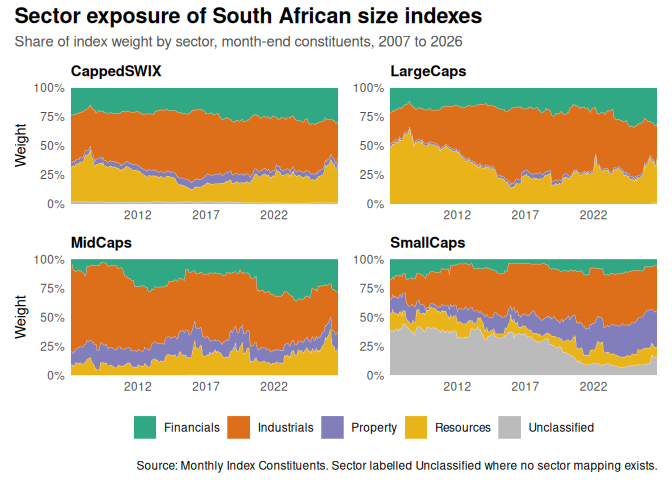<!-- -->

``` r
ggsave("figures/sector_exposure_plot.png",sector_exposure_plot)
```

    ## Saving 7 x 5 in image

``` r
sector_summary <- sector_ret %>%
  filter(Index %in% idx_order) %>%
  group_by(Index, Sector) %>%
  filter(n() > 500) %>%
  summarise(AnnRet = prod(1 + Return)^(252 / n()) - 1,
            AnnVol = sd(Return) * sqrt(252),
            RetPerRisk = AnnRet / AnnVol, .groups = "drop") %>%
  mutate(Index = factor(Index, levels = idx_order))
```

``` r
## Plotting sector returns
sector_ret <- build_index_returns(panel %>% filter(Index %in% c(idx_levels, "CappedSWIX")),
                                  by = c("Index", "Sector"))

sector_ret_clean <- sector_ret %>%
  filter(Index %in% idx_order) %>%
  drop_short_series(min_days = 500)


sector_growth_plot <- plot_sector_growth(sector_ret_clean %>% filter(Index %in% idx_order))
sector_growth_plot
```

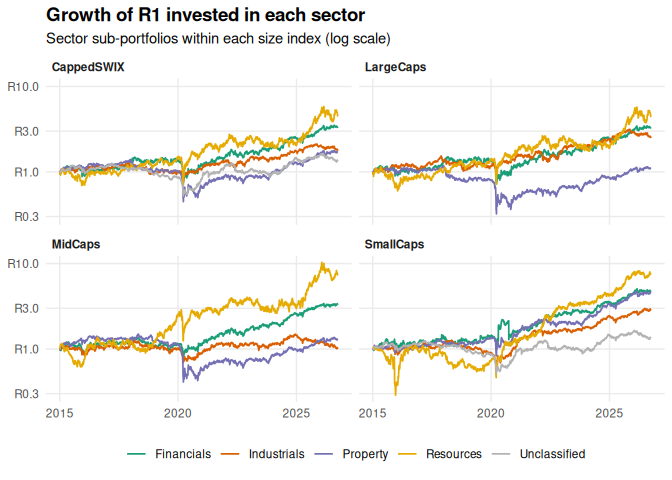<!-- -->

``` r
ggsave("figures/sector_growth_plot.png",sector_growth_plot)
```

    ## Saving 7 x 5 in image

``` r
sector_summary %>% arrange(Index, desc(RetPerRisk)) %>% knitr::kable(digits = 3)
```

| Index     | Sector       | AnnRet | AnnVol | RetPerRisk |
|:----------|:-------------|-------:|-------:|-----------:|
| LargeCaps | Financials   |  0.106 |  0.247 |      0.429 |
| LargeCaps | Resources    |  0.139 |  0.329 |      0.422 |
| LargeCaps | Industrials  |  0.082 |  0.197 |      0.414 |
| LargeCaps | Property     |  0.008 |  0.239 |      0.032 |
| MidCaps   | Financials   |  0.108 |  0.193 |      0.557 |
| MidCaps   | Resources    |  0.189 |  0.348 |      0.543 |
| MidCaps   | Property     |  0.022 |  0.217 |      0.101 |
| MidCaps   | Industrials  |  0.001 |  0.185 |      0.003 |
| SmallCaps | Property     |  0.140 |  0.190 |      0.735 |
| SmallCaps | Resources    |  0.190 |  0.336 |      0.564 |
| SmallCaps | Industrials  |  0.096 |  0.182 |      0.527 |
| SmallCaps | Financials   |  0.141 |  0.286 |      0.494 |
| SmallCaps | Unclassified |  0.025 |  0.175 |      0.145 |

``` r
sector_riskret_plot <- sector_summary %>%
  ggplot(aes(AnnVol, AnnRet, colour = Sector, shape = Index)) +
  geom_point(size = 3) +
  scale_colour_manual(values = sector_cols) +
  scale_x_continuous(labels = scales::percent) +
  scale_y_continuous(labels = scales::percent) +
  labs(title = "Sector risk and return across size indexes",
       x = "Annualised volatility", y = "Annualised return") +
  theme_minimal(base_size = 11)
```

Stock concentration

``` r
conc <- concentration(cons) %>% filter(Index %in% c(idx_levels, bench))

conc_plot <- conc %>% ggplot(aes(date, EffN, colour = Index)) + geom_line() +
  labs(title = "Effective number of stocks (1/HHI)", x = NULL, y = NULL) + theme_minimal()

conc %>% group_by(Index) %>%
  summarise(across(c(N, EffN, Top10), mean)) %>% kable(digits = 2)
```

| Index      |      N |  EffN | Top10 |
|:-----------|-------:|------:|------:|
| CappedSWIX | 148.29 | 31.65 |  0.46 |
| LargeCaps  |  39.75 | 15.08 |  0.66 |
| MidCaps    |  53.25 | 36.31 |  0.41 |
| SmallCaps  |  59.30 | 42.72 |  0.35 |

``` r
# One information-criteria table per index
ic_tables <- idx_ret %>% group_split(Index) %>% set_names(map_chr(., ~ .x$Index[1])) %>%
  map(~ fit_models(.x$Return))
ic_tables[[1]] %>% kable(digits = 3, caption = "Information criteria")  # repeat or bind for all
```

|              | sGARCH | gjrGARCH | eGARCH | apARCH |
|:-------------|-------:|---------:|-------:|-------:|
| Akaike       | -6.395 |   -6.417 | -6.420 | -6.407 |
| Bayes        | -6.384 |   -6.404 | -6.408 | -6.393 |
| Shibata      | -6.395 |   -6.417 | -6.420 | -6.407 |
| Hannan-Quinn | -6.391 |   -6.412 | -6.416 | -6.402 |

Information criteria

eGARCH scores the lowest on all four tests. Hence I use it for the
volatility modelling

``` r
e_spec <- ugarchspec(
  variance.model = list(model = "eGARCH", garchOrder = c(1, 1)),
  mean.model     = list(armaOrder = c(1, 0), include.mean = TRUE),
  distribution.model = "norm")

e_sigma <- function(df) {
  fit <- tryCatch(ugarchfit(e_spec, data = as.numeric(df$Return)), error = function(e) NULL)
  if (is.null(fit)) return(tibble(date = df$date, Sigma = NA_real_))
  tibble(date = df$date, Sigma = as.numeric(sigma(fit)) * sqrt(252))
}

idx_vol <- idx_ret %>% arrange(date) %>% group_by(Index) %>% group_modify(~ e_sigma(.x))

sector_vol <- sector_ret %>% arrange(date) %>%
  group_by(Index, Sector) %>% filter(n() > 500) %>%     # skip tiny sectors
  group_modify(~ e_sigma(.x))

# Lets Facet wrap on Index showing conditional volatility
eGARCH_vol_plot <- idx_vol %>% ggplot(aes(date, Sigma, colour = Index)) + geom_line() +
  facet_wrap("Index")+
  scale_y_continuous(labels = percent) +
  labs(title = "e-GARCH annualised volatility", x = NULL, y = NULL) + theme_minimal()
eGARCH_vol_plot
```

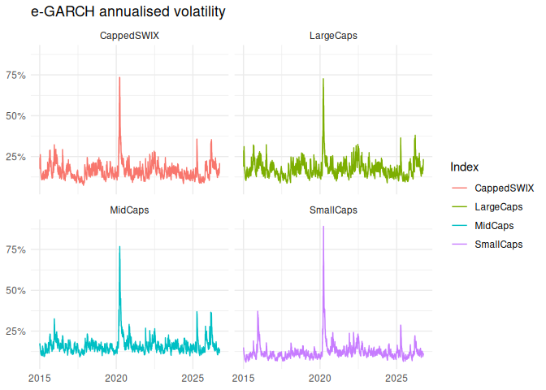<!-- -->

``` r
sector_vol_plot <- sector_vol %>% group_by(Index, Sector) %>% summarise(AvgVol = mean(Sigma, na.rm = TRUE), .groups = "drop") %>% drop_na() %>%
  ggplot(aes(Index, Sector, fill = AvgVol)) + geom_tile() +
  scale_fill_viridis_c(labels = percent) + labs(title = "Average sector volatility by size index") +
  theme_minimal()
sector_vol_plot
```

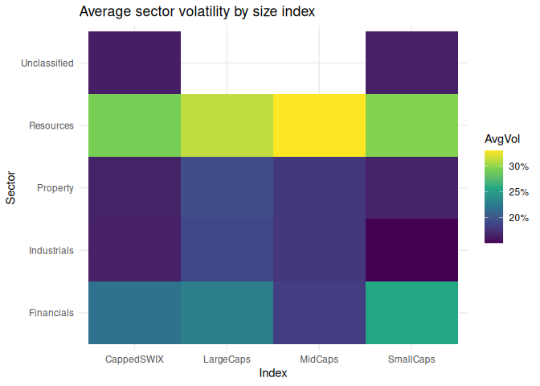<!-- -->

Finally, constituent-level volatility over time, without GARCH (too
heavy for hundreds of stocks), using a rolling 60-day standard
deviation:

``` r
cvol <- constituent_vol(panel %>% filter(Index %in% c(idx_levels, "CappedSWIX" )))
cvol_plot <- cvol %>% ggplot(aes(date, MedianVol, colour = Index)) + geom_line() +
  labs(title = "Median constituent volatility (60d, annualised)") + theme_minimal()
```

Rolling returns and regime stratification

``` r
rr <- bind_rows(rolling_ret(idx_ret, 1), rolling_ret(idx_ret, 3))

rr_plot <- rr %>% #filter(Window %in% "3Y") %>%
  drop_na() %>% ggplot(aes(date, RollRet, colour = Index)) + geom_line() +
  facet_wrap(~Window, ncol = 1) +
    scale_y_continuous(labels = percent) +
  labs(title = "Rolling annualised returns", x = NULL, y = NULL) + theme_minimal()
rr_plot
```

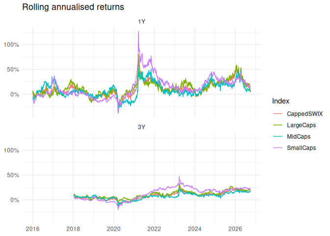<!-- -->

``` r
# Risk/return summary
summary_tbl <- idx_ret %>% group_by(Index) %>%
  summarise(AnnRet = (prod(1 + Return)^(252 / n()) - 1)*100,
            AnnVol = sd(Return) * sqrt(252)*100,
            RetPerRisk = AnnRet / AnnVol,
            MaxDD = min(cumprod(1 + Return) / cummax(cumprod(1 + Return)) - 1))
kable(summary_tbl, digits = 3)
```

| Index      | AnnRet | AnnVol | RetPerRisk |  MaxDD |
|:-----------|-------:|-------:|-----------:|-------:|
| CappedSWIX |  8.865 | 17.608 |      0.503 | -0.443 |
| LargeCaps  | 10.898 | 18.768 |      0.581 | -0.385 |
| MidCaps    |  7.486 | 17.541 |      0.427 | -0.426 |
| SmallCaps  | 11.938 | 15.020 |      0.795 | -0.494 |

``` r
# Stratification by volatility regime (terciles of Capped SWIX GJR vol)
regimes <- idx_vol %>% filter(Index == bench) %>%
  mutate(Regime = ntile(Sigma, 3) %>% factor(labels = c("Low vol", "Mid vol", "High vol"))) %>%
  ungroup() %>% 
  select(-Index)

  regime_tbl <- idx_ret %>% inner_join(regimes, by = "date") %>% group_by(Index, Regime) %>%
  summarise(AnnRet = (mean(Return) * 252)*100, AnnVol = sd(Return) * sqrt(252)*100, .groups = "drop")
```

Calculating alpha share

``` r
AS <- active_share(cons, bench, idx_levels)

as_plot <- AS %>% ggplot(aes(date, ActiveShare, colour = Index)) + geom_line() +
  scale_y_continuous(labels = percent, limits = c(0, 1)) +
  labs(title = "Active share vs Capped SWIX") + theme_minimal()
as_plot
```

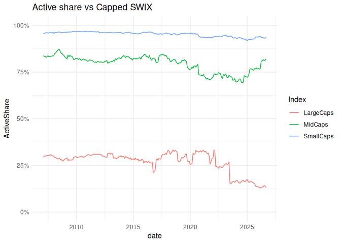<!-- -->

# Question 3

``` r
# data prep
bench_monthly <- Idx_Daily %>%
  filter(Tickers == "J433") %>%
  mutate(
    date = as.Date(date),
    ym   = floor_date(date, "month")
  ) %>%
  arrange(date) %>%
  group_by(ym) %>%
  summarise(
    Name    = "Capped SWIX",
    date    = max(date),
    returns = prod(1 + Returns, na.rm = TRUE) - 1,
    .groups = "drop"
  ) %>%
  select(Name, date, returns)

peers_clean <- Active_Manager_Peers %>%
  mutate(date = as.Date(date)) %>%
  rename(returns = Returns)

abc_clean <- ABC_Fund %>%
  mutate(date = as.Date(date)) %>%
  rename(returns = Returns)

q3data <- bind_rows(bench_monthly, peers_clean, abc_clean) %>%
  filter(date >= as.Date("2015-01-30") & date <= "2025-10-31")

write_rds(q3data, "data/q3data.rds")
```

``` r
 bench    <- "Capped SWIX"
fund     <- "ABC_Fund"
win      <- 36L          # months: rolling beta / R2 / excess return window
min_n    <- 5L           # min funds in a month to compute dispersion
anon     <- TRUE        # anonymise peers for the conference

pal <- c("ABC Fund" = "#D55E00", "Peer" = "grey60", "Benchmark" = "#1F3A5F")
```

## Data

``` r
df <- load_returns("data/q3data.rds") %>% add_role()
if (anon) df <- anonymise_peers(df)

df %>% group_by(role) %>% summarise(Funds = n_distinct(name), From = min(date), To = max(date)) %>% kable()
```

| role      | Funds | From       | To         |
|:----------|------:|:-----------|:-----------|
| ABC Fund  |     1 | 2015-01-31 | 2025-10-31 |
| Benchmark |     1 | 2015-01-31 | 2025-10-31 |
| Peer      |   225 | 2015-01-31 | 2025-10-31 |

## 1. How high is typical peer beta?

``` r
roll <- rolling_stats(df, window = 36)
```

``` r
# the data frame the function expects: columns date, name, role, rolling_beta
beta_df <- roll %>%
  drop_na(beta) %>%
  rename(rolling_beta = beta)

beta_plot <- plot_rolling_beta(beta_df)
beta_plot
```

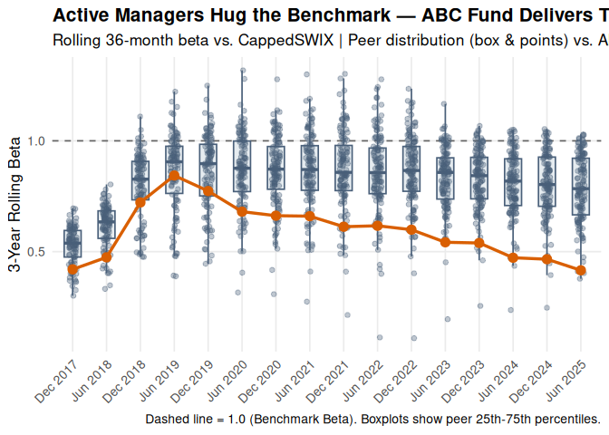<!-- -->

``` r
# Latest-window snapshot: peer median vs ABC
roll %>% drop_na(beta) %>% group_by(date) %>% filter(any(role == "ABC Fund")) %>% ungroup() %>%
  filter(date == max(date)) %>% group_by(role) %>%
  summarise(across(c(beta, r2, te), median)) %>% kable(digits = 2, caption = "Latest rolling window (median)")
```

| role     | beta |   r2 |   te |
|:---------|-----:|-----:|-----:|
| ABC Fund | 0.40 | 0.40 | 0.10 |
| Peer     | 0.76 | 0.83 | 0.06 |

Latest rolling window (median)

## 2. How much of each fund is just the market?

``` r
r2_plot <- plot_box_overlay(roll, r2,
  title = "Rolling 36m R-squared vs CappedSWIX",
  subtitle = "Lower = more of the fund's return pattern comes from something other than the market",
  ylab = NULL, y_labels = percent_format(accuracy = 1))
r2_plot
```

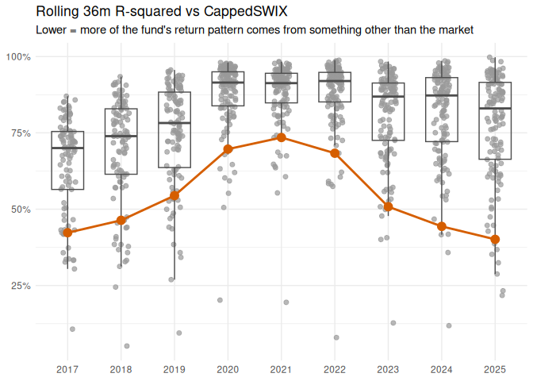<!-- -->

## 3. Do ABC’s returns have different drivers?

``` r
wide  <- to_wide(df)
funds <- wide %>% select(-date, -all_of(bench))

# Strip out the market from each fund, then correlate what is left
resids <- map_dfc(funds, function(x) {
  ok <- complete.cases(x, wide[[bench]])
  if (sum(ok) < 3L) return(rep(NA_real_, length(x)))
  resid(lm(x ~ wide[[bench]], na.action = na.exclude))
})

driver_tbl <- inner_join(avg_pairwise_cor(funds), avg_pairwise_cor(resids),
                         by = "name", suffix = c("_raw", "_resid")) %>%
  left_join(distinct(df, name, role), by = "name")

driver_tbl %>% group_by(role) %>% summarise(across(starts_with("avg_cor"), median)) %>% kable(digits = 2)
```

| role     | avg_cor_raw | avg_cor_resid |
|:---------|------------:|--------------:|
| ABC Fund |        0.71 |          0.27 |
| Peer     |        0.80 |               |

``` r
driver_long <- driver_tbl %>%
  drop_na(avg_cor_raw, avg_cor_resid) %>%
  mutate(name = fct_reorder(name, avg_cor_resid)) %>%
  pivot_longer(c(avg_cor_raw, avg_cor_resid), names_to = "measure", values_to = "cor") %>%
  mutate(measure = recode(measure,
                          avg_cor_raw = "Raw returns",
                          avg_cor_resid = "After removing market"))

driver_plot <- driver_long %>%
  ggplot(aes(cor, name)) +
  geom_line(aes(group = name), colour = "grey85", linewidth = 0.4) +
  geom_line(
    data = filter(driver_long, role == "ABC Fund"),
    aes(group = name),
    colour = pal[["ABC Fund"]],
    linewidth = 1
  ) +
  geom_point(aes(colour = role, shape = measure), size = 2.5) +
  geom_point(
    data = filter(driver_long, role == "ABC Fund"),
    aes(colour = role, shape = measure),
    size = 3.5
  ) +
  scale_colour_manual(values = pal, guide = "none") +
  scale_shape_manual(values = c("Raw returns" = 1, "After removing market" = 16), name = NULL) +
  scale_y_discrete(breaks = fund) +
  scale_x_continuous(labels = number_format(accuracy = 0.01)) +
  labs(title = "How similar is each fund to the rest of the industry?",
       subtitle = "Average correlation with other active funds",
       x = NULL, y = NULL) +
  theme_minimal() +
  theme(
    panel.grid.major.y = element_blank(),
    axis.text.y = element_text(face = "bold", colour = pal[["ABC Fund"]]),
    legend.position = "top"
  )

driver_plot
```

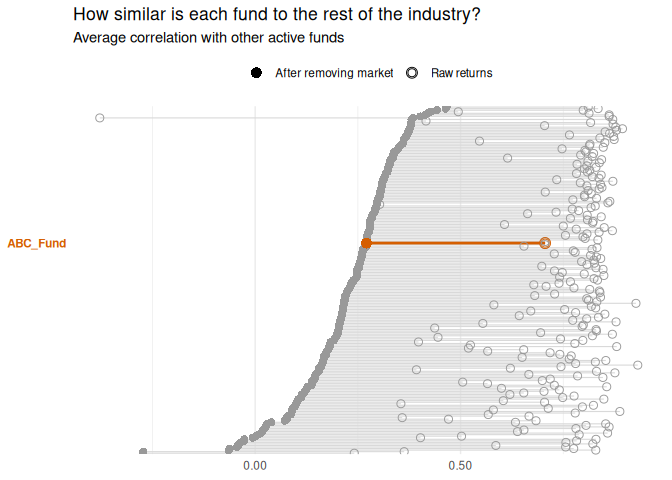<!-- -->

## 4. Relative performance over time

``` r
ex <- rolling_excess(df, win)

fan <- ex %>% group_by(date) %>%
  summarise(p10 = quantile(excess[role == "Peer"], .10), p25 = quantile(excess[role == "Peer"], .25),
            med = median(excess[role == "Peer"]),
            p75 = quantile(excess[role == "Peer"], .75), p90 = quantile(excess[role == "Peer"], .90),
            .groups = "drop") %>%
  left_join(ex %>% filter(role == "ABC Fund") %>% select(date, abc = excess), by = "date")

fan %>% drop_na(abc) %>% summarise(`Share of months ABC above peer median` = mean(abc > med)) %>%
  kable(digits = 2)
```

| Share of months ABC above peer median |
|--------------------------------------:|
|                                  0.87 |

``` r
fan_plot <- fan %>% ggplot(aes(date)) +
  geom_hline(yintercept = 0, colour = pal[["Benchmark"]], linetype = "dashed") +
  geom_ribbon(aes(ymin = p10, ymax = p90), fill = "grey70", alpha = 0.35) +
  geom_ribbon(aes(ymin = p25, ymax = p75), fill = "grey50", alpha = 0.45) +
  geom_line(aes(y = med), colour = "grey30", linetype = "dotted") +
  geom_line(aes(y = abc), colour = pal[["ABC Fund"]], linewidth = 1.2, na.rm = TRUE) +
  scale_y_continuous(labels = percent_format(accuracy = 1)) +
  labs(title = "ABC Fund vs the peer fan",
       subtitle = "Rolling 36m annualised excess return. Bands = middle 80% / 50% of peers, dotted = median",
       x = NULL, y = NULL) + theme_minimal()
fan_plot
```

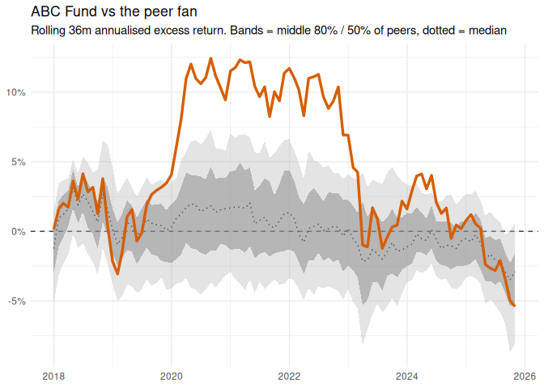<!-- -->

``` r
ranks <- calendar_ranks(df, bench = "Capped SWIX" )
ranks %>% filter(role == "ABC Fund") %>% select(year, ret, rank, n_funds) %>% kable(digits = 3)
```

| year |    ret | rank | n_funds |
|-----:|-------:|-----:|--------:|
| 2015 |  0.184 |    3 |     107 |
| 2016 | -0.064 |  114 |     124 |
| 2017 |  0.110 |   77 |     128 |
| 2018 | -0.057 |   31 |     136 |
| 2019 |  0.188 |    8 |     133 |
| 2020 |  0.189 |    1 |     140 |
| 2021 |  0.305 |   38 |     140 |
| 2022 |  0.032 |   67 |     146 |
| 2023 |  0.109 |   28 |     142 |
| 2024 |  0.140 |   60 |     143 |

``` r
ranks_ordered <- ranks %>%
  mutate(
    name = fct_reorder(name, pct, .fun = mean),
    year = factor(year)
  )

abc_row <- which(levels(ranks_ordered$name) == fund)

abc_ranks <- ranks_ordered %>%
  filter(role == "ABC Fund") %>%
  mutate(
    x_num = as.numeric(year),
    lab   = sprintf("%d/%d", rank, n_funds)
  )

rank_plot <- ranks_ordered %>%
  ggplot(aes(year, name, fill = pct)) +
  geom_tile(colour = "white", linewidth = 0.1) +
  geom_rect(
    data = abc_ranks,
    aes(
      xmin = x_num - 0.5,
      xmax = x_num + 0.5,
      ymin = abc_row - 1.2,
      ymax = abc_row + 1.2
    ),
    inherit.aes = FALSE,
    fill = NA,
    colour = "black",
    linewidth = 0.45
  ) +
  geom_text(
    data = abc_ranks,
    aes(x = year, y = abc_row + 1.5, label = lab),
    inherit.aes = FALSE,
    size = 3,
    vjust = 0
  ) +
  scale_y_discrete(breaks = fund) +
  scale_fill_gradient2(
    low = "#B2182B", mid = "white", high = "#2166AC",
    midpoint = 0.5, labels = percent_format(), name = "Percentile rank"
  ) +
  coord_cartesian(clip = "off") +
  labs(
    title = "Calendar-year ranking",
    subtitle = "ABC Fund boxed: rank / number of funds",
    x = NULL,
    y = NULL
  ) +
  theme_minimal() +
     theme(
      axis.text.x = element_text(angle = 45, hjust = 1),
      panel.grid.minor = element_blank(),
      plot.title = element_text(face = "bold")
    )

rank_plot
```

<!-- -->

Note: if `anon` is TRUE the ABC row keeps its name, so the
`mutate(name = fund)` above matches. If you change `fund` to a name that
gets anonymised, adjust accordingly.

## 5. Does ABC do well when dispersion is high?

``` r
panel <- dispersion_panel(df, min_n)

abc_panel <- panel %>% filter(role == "ABC Fund") %>%
  mutate(bucket = factor(ntile(dispersion, 3), labels = c("Low", "Medium", "High")))

bucket_tbl <- abc_panel %>% group_by(bucket) %>%
  summarise(AvgRel = mean(rel), HitRate = mean(rel > 0), Months = n(), .groups = "drop")
kable(bucket_tbl, digits = 4)
```

| bucket | AvgRel | HitRate | Months |
|:-------|-------:|--------:|-------:|
| Low    | 0.0016 |  0.5000 |     44 |
| Medium | 0.0033 |  0.5116 |     43 |
| High   | 0.0041 |  0.5116 |     43 |

``` r
# Formal test: is the slope of relative return on dispersion positive?
lm(rel ~ dispersion, data = abc_panel) %>% tidy(conf.int = TRUE) %>% kable(digits = 4)
```

| term        | estimate | std.error | statistic | p.value | conf.low | conf.high |
|:------------|---------:|----------:|----------:|--------:|---------:|----------:|
| (Intercept) |  -0.0025 |    0.0050 |   -0.4916 |  0.6239 |  -0.0123 |    0.0074 |
| dispersion  |   0.0034 |    0.0029 |    1.1677 |  0.2451 |  -0.0024 |    0.0091 |

``` r
disp_scatter <- abc_panel %>% ggplot(aes(dispersion, rel)) +
  geom_hline(yintercept = 0, colour = "grey50") +
  geom_point(colour = pal[["ABC Fund"]], alpha = 0.7, size = 2) +
  geom_smooth(method = "lm", colour = "black", fill = "grey80") +
  scale_y_continuous(labels = percent_format(accuracy = 1)) +
  labs(title = "Monthly relative return vs dispersion",
       x = "Cross-sectional dispersion (pp)", y = "ABC minus peer median") + theme_minimal()

disp_bars <- bucket_tbl %>% ggplot(aes(bucket, AvgRel)) +
  geom_col(fill = pal[["ABC Fund"]], width = 0.6) +
  geom_hline(yintercept = 0) +
  geom_text(aes(label = paste0("Beats median\nin ", percent(HitRate, 1), " of months")), vjust = -0.3, size = 3.2) +
  scale_y_continuous(labels = percent_format(accuracy = 0.1), expand = expansion(mult = c(0.05, 0.25))) +
  labs(title = "By dispersion tercile", x = NULL, y = "Avg monthly outperformance") + theme_minimal()

#disp_plot <- disp_scatter + disp_bars + plot_layout(widths = c(1.3, 1))
disp_plot <- disp_scatter +   theme(
      axis.text.x = element_text(angle = 45, hjust = 1),
      panel.grid.minor = element_blank(),
      plot.title = element_text(face = "bold")
    )
disp_plot
```

    ## `geom_smooth()` using formula = 'y ~ x'

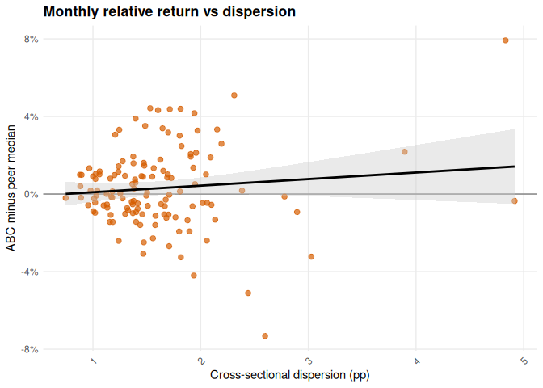<!-- -->

``` r
# Same regression for every fund: is ABC unusual?
slopes <- dispersion_slopes(panel)
```

    ## Warning: There was 1 warning in `mutate()`.
    ## ℹ In argument: `tidy = map(fit, ~tidy(.x, conf.int = TRUE))`.
    ## ℹ In group 104: `name = "Peer 183"`, `role = "Peer"`.
    ## Caused by warning in `qt()`:
    ## ! NaNs produced

``` r
slopes %>% arrange(desc(estimate)) %>% select(name, role, estimate, conf.low, conf.high, p.value) %>%
  kable(digits = 4)
```

| name        | role      | estimate | conf.low | conf.high | p.value |
|:------------|:----------|---------:|---------:|----------:|--------:|
| Peer 108    | Peer      |   0.0369 |   0.0176 |    0.0562 |  0.0145 |
| Peer 225    | Peer      |   0.0276 |  -0.0075 |    0.0627 |  0.1187 |
| Peer 38     | Peer      |   0.0271 |   0.0057 |    0.0485 |  0.0154 |
| Peer 179    | Peer      |   0.0211 |  -0.0067 |    0.0488 |  0.1205 |
| Peer 116    | Peer      |   0.0177 |   0.0076 |    0.0277 |  0.0081 |
| Peer 184    | Peer      |   0.0117 |  -0.0044 |    0.0278 |  0.1499 |
| Peer 21     | Peer      |   0.0091 |   0.0012 |    0.0170 |  0.0247 |
| Peer 94     | Peer      |   0.0087 |  -0.0150 |    0.0324 |  0.4380 |
| Peer 213    | Peer      |   0.0085 |   0.0021 |    0.0149 |  0.0126 |
| Peer 172    | Peer      |   0.0080 |   0.0032 |    0.0129 |  0.0013 |
| Peer 65     | Peer      |   0.0080 |   0.0000 |    0.0160 |  0.0501 |
| Peer 154    | Peer      |   0.0078 |  -0.0016 |    0.0171 |  0.1013 |
| Peer 36     | Peer      |   0.0077 |  -0.0091 |    0.0244 |  0.3559 |
| Peer 48     | Peer      |   0.0076 |   0.0012 |    0.0141 |  0.0219 |
| Peer 68     | Peer      |   0.0076 |   0.0017 |    0.0136 |  0.0178 |
| Peer 83     | Peer      |   0.0075 |  -0.0012 |    0.0162 |  0.0885 |
| Peer 125    | Peer      |   0.0072 |   0.0028 |    0.0115 |  0.0019 |
| Peer 37     | Peer      |   0.0071 |   0.0037 |    0.0106 |  0.0001 |
| Peer 136    | Peer      |   0.0062 |  -0.0041 |    0.0164 |  0.2301 |
| Peer 45     | Peer      |   0.0061 |  -0.0057 |    0.0179 |  0.2980 |
| Peer 18     | Peer      |   0.0058 |  -0.0019 |    0.0135 |  0.1341 |
| Peer 54     | Peer      |   0.0057 |  -0.0031 |    0.0145 |  0.1945 |
| Peer 30     | Peer      |   0.0051 |  -0.0015 |    0.0116 |  0.1272 |
| Peer 98     | Peer      |   0.0050 |  -0.0016 |    0.0116 |  0.1379 |
| Peer 163    | Peer      |   0.0049 |  -0.0016 |    0.0115 |  0.1369 |
| Peer 196    | Peer      |   0.0048 |   0.0007 |    0.0089 |  0.0225 |
| Peer 95     | Peer      |   0.0048 |   0.0015 |    0.0081 |  0.0049 |
| Peer 24     | Peer      |   0.0047 |  -0.0180 |    0.0275 |  0.6576 |
| Peer 185    | Peer      |   0.0046 |   0.0010 |    0.0082 |  0.0118 |
| Peer 164    | Peer      |   0.0046 |   0.0009 |    0.0082 |  0.0141 |
| Peer 78     | Peer      |   0.0043 |   0.0012 |    0.0074 |  0.0067 |
| Peer 76     | Peer      |   0.0043 |  -0.0021 |    0.0107 |  0.1869 |
| Peer 194    | Peer      |   0.0042 |   0.0010 |    0.0074 |  0.0100 |
| Peer 105    | Peer      |   0.0042 |  -0.0003 |    0.0087 |  0.0695 |
| Peer 218    | Peer      |   0.0038 |   0.0010 |    0.0066 |  0.0077 |
| Peer 186    | Peer      |   0.0037 |   0.0001 |    0.0073 |  0.0428 |
| Peer 27     | Peer      |   0.0037 |   0.0011 |    0.0063 |  0.0060 |
| Peer 181    | Peer      |   0.0037 |  -0.0001 |    0.0075 |  0.0576 |
| Peer 166    | Peer      |   0.0037 |  -0.0056 |    0.0129 |  0.4097 |
| Peer 167    | Peer      |   0.0036 |  -0.0008 |    0.0081 |  0.1066 |
| Peer 110    | Peer      |   0.0036 |   0.0014 |    0.0058 |  0.0015 |
| Peer 22     | Peer      |   0.0036 |  -0.0035 |    0.0106 |  0.3137 |
| Peer 165    | Peer      |   0.0034 |  -0.0131 |    0.0199 |  0.6798 |
| ABC_Fund    | ABC Fund  |   0.0034 |  -0.0024 |    0.0091 |  0.2451 |
| Peer 200    | Peer      |   0.0034 |  -0.0024 |    0.0091 |  0.2451 |
| Peer 03     | Peer      |   0.0034 |  -0.0027 |    0.0095 |  0.2705 |
| Peer 70     | Peer      |   0.0033 |   0.0005 |    0.0062 |  0.0222 |
| Peer 04     | Peer      |   0.0032 |  -0.0018 |    0.0081 |  0.2027 |
| Peer 201    | Peer      |   0.0032 |  -0.0003 |    0.0067 |  0.0758 |
| Peer 151    | Peer      |   0.0032 |  -0.0016 |    0.0079 |  0.1827 |
| Peer 107    | Peer      |   0.0031 |  -0.0012 |    0.0074 |  0.1542 |
| Peer 10     | Peer      |   0.0031 |  -0.0001 |    0.0063 |  0.0595 |
| Peer 81     | Peer      |   0.0031 |  -0.0009 |    0.0070 |  0.1282 |
| Peer 150    | Peer      |   0.0030 |  -0.0017 |    0.0078 |  0.2046 |
| Peer 11     | Peer      |   0.0030 |  -0.0001 |    0.0060 |  0.0544 |
| Peer 08     | Peer      |   0.0030 |  -0.0146 |    0.0206 |  0.7356 |
| Peer 67     | Peer      |   0.0029 |  -0.0036 |    0.0094 |  0.3706 |
| Peer 147    | Peer      |   0.0028 |  -0.0022 |    0.0079 |  0.2705 |
| Peer 191    | Peer      |   0.0028 |  -0.0031 |    0.0087 |  0.3435 |
| Peer 188    | Peer      |   0.0028 |  -0.0022 |    0.0077 |  0.2708 |
| Peer 174    | Peer      |   0.0027 |  -0.0008 |    0.0062 |  0.1191 |
| Peer 133    | Peer      |   0.0027 |  -0.0017 |    0.0071 |  0.2219 |
| Peer 216    | Peer      |   0.0027 |  -0.0012 |    0.0066 |  0.1719 |
| Peer 208    | Peer      |   0.0027 |  -0.0005 |    0.0058 |  0.0989 |
| Peer 146    | Peer      |   0.0026 |  -0.0006 |    0.0059 |  0.1072 |
| Peer 05     | Peer      |   0.0026 |  -0.0011 |    0.0063 |  0.1696 |
| Peer 182    | Peer      |   0.0025 |  -0.0019 |    0.0069 |  0.2481 |
| Peer 07     | Peer      |   0.0024 |  -0.0026 |    0.0075 |  0.3318 |
| Peer 32     | Peer      |   0.0024 |  -0.0078 |    0.0126 |  0.6362 |
| Peer 145    | Peer      |   0.0024 |  -0.0016 |    0.0064 |  0.2434 |
| Peer 77     | Peer      |   0.0024 |  -0.0348 |    0.0395 |  0.8871 |
| Peer 43     | Peer      |   0.0023 |  -0.0017 |    0.0064 |  0.2556 |
| Peer 63     | Peer      |   0.0023 |  -0.0060 |    0.0105 |  0.5839 |
| Peer 212    | Peer      |   0.0023 |  -0.0065 |    0.0110 |  0.6026 |
| Peer 57     | Peer      |   0.0021 |  -0.0063 |    0.0105 |  0.6150 |
| Peer 143    | Peer      |   0.0021 |  -0.0025 |    0.0066 |  0.3574 |
| Peer 155    | Peer      |   0.0021 |  -0.0010 |    0.0051 |  0.1905 |
| Peer 16     | Peer      |   0.0020 |  -0.0033 |    0.0073 |  0.4362 |
| Peer 31     | Peer      |   0.0019 |  -0.0014 |    0.0053 |  0.2457 |
| Peer 223    | Peer      |   0.0019 |  -0.0048 |    0.0086 |  0.5737 |
| Peer 72     | Peer      |   0.0018 |  -0.0008 |    0.0044 |  0.1619 |
| Peer 211    | Peer      |   0.0018 |  -0.0018 |    0.0054 |  0.3171 |
| Peer 39     | Peer      |   0.0017 |  -0.0021 |    0.0056 |  0.3667 |
| Peer 109    | Peer      |   0.0017 |  -0.0025 |    0.0060 |  0.4262 |
| Peer 192    | Peer      |   0.0017 |  -0.0036 |    0.0070 |  0.5277 |
| Peer 198    | Peer      |   0.0016 |  -0.0024 |    0.0057 |  0.4085 |
| Peer 129    | Peer      |   0.0016 |  -0.0012 |    0.0043 |  0.2683 |
| Peer 119    | Peer      |   0.0015 |  -0.0019 |    0.0050 |  0.3732 |
| Peer 34     | Peer      |   0.0015 |  -0.0027 |    0.0057 |  0.4756 |
| Peer 219    | Peer      |   0.0015 |  -0.0040 |    0.0070 |  0.5939 |
| Peer 93     | Peer      |   0.0014 |  -0.0024 |    0.0052 |  0.4677 |
| Peer 141    | Peer      |   0.0014 |  -0.0022 |    0.0049 |  0.4418 |
| Peer 89     | Peer      |   0.0013 |   0.0001 |    0.0024 |  0.0278 |
| Peer 156    | Peer      |   0.0013 |  -0.0039 |    0.0065 |  0.6265 |
| Peer 178    | Peer      |   0.0012 |  -0.0044 |    0.0069 |  0.6643 |
| Peer 193    | Peer      |   0.0012 |  -0.0036 |    0.0061 |  0.6162 |
| Peer 137    | Peer      |   0.0012 |  -0.0019 |    0.0043 |  0.4360 |
| Peer 177    | Peer      |   0.0011 |  -0.0043 |    0.0065 |  0.6774 |
| Capped SWIX | Benchmark |   0.0011 |  -0.0029 |    0.0052 |  0.5838 |
| Peer 215    | Peer      |   0.0010 |  -0.0036 |    0.0056 |  0.6584 |
| Peer 134    | Peer      |   0.0010 |  -0.0021 |    0.0041 |  0.5088 |
| Peer 162    | Peer      |   0.0007 |  -0.0022 |    0.0037 |  0.6194 |
| Peer 82     | Peer      |   0.0007 |  -0.0030 |    0.0044 |  0.7031 |
| Peer 159    | Peer      |   0.0007 |  -0.0078 |    0.0092 |  0.8687 |
| Peer 195    | Peer      |   0.0007 |  -0.0028 |    0.0041 |  0.6978 |
| Peer 91     | Peer      |   0.0006 |  -0.0045 |    0.0058 |  0.8065 |
| Peer 140    | Peer      |   0.0006 |  -0.0035 |    0.0047 |  0.7592 |
| Peer 28     | Peer      |   0.0006 |  -0.0059 |    0.0071 |  0.8478 |
| Peer 104    | Peer      |   0.0006 |  -0.0050 |    0.0061 |  0.8424 |
| Peer 64     | Peer      |   0.0005 |  -0.0023 |    0.0034 |  0.7076 |
| Peer 26     | Peer      |   0.0005 |  -0.0029 |    0.0039 |  0.7662 |
| Peer 139    | Peer      |   0.0005 |  -0.0012 |    0.0022 |  0.5586 |
| Peer 79     | Peer      |   0.0005 |  -0.0064 |    0.0074 |  0.8864 |
| Peer 214    | Peer      |   0.0005 |  -0.0045 |    0.0055 |  0.8524 |
| Peer 90     | Peer      |   0.0004 |  -0.0030 |    0.0039 |  0.7947 |
| Peer 148    | Peer      |   0.0004 |  -0.0020 |    0.0028 |  0.7245 |
| Peer 96     | Peer      |   0.0004 |  -0.0033 |    0.0041 |  0.8298 |
| Peer 12     | Peer      |   0.0004 |  -0.0126 |    0.0133 |  0.9565 |
| Peer 180    | Peer      |   0.0003 |  -0.0060 |    0.0067 |  0.9157 |
| Peer 152    | Peer      |   0.0003 |  -0.0029 |    0.0035 |  0.8452 |
| Peer 117    | Peer      |   0.0001 |  -0.0051 |    0.0052 |  0.9747 |
| Peer 131    | Peer      |   0.0000 |  -0.0030 |    0.0030 |  0.9985 |
| Peer 128    | Peer      |   0.0000 |  -0.0034 |    0.0033 |  0.9794 |
| Peer 209    | Peer      |  -0.0001 |  -0.0046 |    0.0045 |  0.9786 |
| Peer 170    | Peer      |  -0.0001 |  -0.0034 |    0.0032 |  0.9628 |
| Peer 122    | Peer      |  -0.0001 |  -0.0102 |    0.0099 |  0.9763 |
| Peer 112    | Peer      |  -0.0002 |  -0.0033 |    0.0029 |  0.9081 |
| Peer 84     | Peer      |  -0.0002 |  -0.0026 |    0.0022 |  0.8651 |
| Peer 210    | Peer      |  -0.0002 |  -0.0039 |    0.0035 |  0.9073 |
| Peer 44     | Peer      |  -0.0002 |  -0.0093 |    0.0089 |  0.9618 |
| Peer 204    | Peer      |  -0.0002 |  -0.0081 |    0.0077 |  0.9558 |
| Peer 224    | Peer      |  -0.0002 |  -0.0043 |    0.0038 |  0.9039 |
| Peer 14     | Peer      |  -0.0003 |  -0.0035 |    0.0030 |  0.8663 |
| Peer 169    | Peer      |  -0.0003 |  -0.0029 |    0.0023 |  0.8220 |
| Peer 199    | Peer      |  -0.0003 |  -0.0023 |    0.0016 |  0.7342 |
| Peer 55     | Peer      |  -0.0004 |  -0.0037 |    0.0028 |  0.8015 |
| Peer 19     | Peer      |  -0.0004 |  -0.0089 |    0.0080 |  0.9167 |
| Peer 17     | Peer      |  -0.0005 |  -0.0231 |    0.0221 |  0.9649 |
| Peer 100    | Peer      |  -0.0005 |  -0.0035 |    0.0024 |  0.7108 |
| Peer 02     | Peer      |  -0.0006 |  -0.0059 |    0.0047 |  0.8334 |
| Peer 197    | Peer      |  -0.0006 |  -0.0036 |    0.0024 |  0.6823 |
| Peer 56     | Peer      |  -0.0006 |  -0.0082 |    0.0069 |  0.8665 |
| Peer 153    | Peer      |  -0.0006 |  -0.0053 |    0.0040 |  0.7852 |
| Peer 157    | Peer      |  -0.0007 |  -0.0101 |    0.0087 |  0.8835 |
| Peer 135    | Peer      |  -0.0007 |  -0.0097 |    0.0083 |  0.8725 |
| Peer 20     | Peer      |  -0.0008 |  -0.0036 |    0.0020 |  0.5682 |
| Peer 123    | Peer      |  -0.0008 |  -0.0087 |    0.0070 |  0.8114 |
| Peer 102    | Peer      |  -0.0009 |  -0.0045 |    0.0026 |  0.6126 |
| Peer 80     | Peer      |  -0.0010 |  -0.0044 |    0.0024 |  0.5555 |
| Peer 59     | Peer      |  -0.0012 |  -0.0047 |    0.0023 |  0.5065 |
| Peer 88     | Peer      |  -0.0012 |  -0.0146 |    0.0122 |  0.8578 |
| Peer 46     | Peer      |  -0.0012 |  -0.0037 |    0.0013 |  0.3317 |
| Peer 130    | Peer      |  -0.0013 |  -0.0162 |    0.0137 |  0.8644 |
| Peer 206    | Peer      |  -0.0013 |  -0.0041 |    0.0015 |  0.3643 |
| Peer 106    | Peer      |  -0.0015 |  -0.0077 |    0.0048 |  0.5512 |
| Peer 127    | Peer      |  -0.0015 |  -0.0089 |    0.0059 |  0.6877 |
| Peer 149    | Peer      |  -0.0015 |  -0.0069 |    0.0039 |  0.5822 |
| Peer 86     | Peer      |  -0.0015 |  -0.0067 |    0.0036 |  0.5544 |
| Peer 13     | Peer      |  -0.0015 |  -0.0044 |    0.0013 |  0.2906 |
| Peer 144    | Peer      |  -0.0017 |  -0.0080 |    0.0046 |  0.5899 |
| Peer 158    | Peer      |  -0.0017 |  -0.0052 |    0.0018 |  0.3318 |
| Peer 35     | Peer      |  -0.0018 |  -0.0057 |    0.0022 |  0.3720 |
| Peer 40     | Peer      |  -0.0018 |  -0.0059 |    0.0022 |  0.3730 |
| Peer 124    | Peer      |  -0.0019 |  -0.0091 |    0.0054 |  0.6011 |
| Peer 138    | Peer      |  -0.0020 |  -0.0041 |    0.0002 |  0.0702 |
| Peer 173    | Peer      |  -0.0021 |  -0.0064 |    0.0021 |  0.3244 |
| Peer 87     | Peer      |  -0.0021 |  -0.0089 |    0.0046 |  0.4825 |
| Peer 41     | Peer      |  -0.0021 |  -0.0197 |    0.0155 |  0.7953 |
| Peer 73     | Peer      |  -0.0021 |  -0.0056 |    0.0014 |  0.2296 |
| Peer 51     | Peer      |  -0.0024 |  -0.0062 |    0.0014 |  0.2139 |
| Peer 92     | Peer      |  -0.0025 |  -0.0173 |    0.0123 |  0.7345 |
| Peer 121    | Peer      |  -0.0028 |  -0.0087 |    0.0031 |  0.3540 |
| Peer 111    | Peer      |  -0.0028 |  -0.0064 |    0.0008 |  0.1309 |
| Peer 203    | Peer      |  -0.0028 |  -0.0065 |    0.0008 |  0.1281 |
| Peer 103    | Peer      |  -0.0029 |  -0.0253 |    0.0195 |  0.7831 |
| Peer 205    | Peer      |  -0.0029 |  -0.0110 |    0.0052 |  0.4643 |
| Peer 23     | Peer      |  -0.0030 |  -0.0076 |    0.0016 |  0.2024 |
| Peer 176    | Peer      |  -0.0030 |  -0.0174 |    0.0115 |  0.6785 |
| Peer 99     | Peer      |  -0.0030 |  -0.0076 |    0.0016 |  0.1985 |
| Peer 53     | Peer      |  -0.0030 |  -0.0072 |    0.0011 |  0.1532 |
| Peer 69     | Peer      |  -0.0033 |  -0.0087 |    0.0021 |  0.2341 |
| Peer 175    | Peer      |  -0.0033 |  -0.0101 |    0.0034 |  0.3297 |
| Peer 29     | Peer      |  -0.0035 |  -0.0213 |    0.0144 |  0.6937 |
| Peer 160    | Peer      |  -0.0036 |  -0.0134 |    0.0061 |  0.4536 |
| Peer 01     | Peer      |  -0.0036 |  -0.0092 |    0.0020 |  0.2003 |
| Peer 75     | Peer      |  -0.0037 |  -0.0311 |    0.0237 |  0.7677 |
| Peer 202    | Peer      |  -0.0037 |  -0.0123 |    0.0049 |  0.3920 |
| Peer 60     | Peer      |  -0.0038 |  -0.0069 |   -0.0007 |  0.0181 |
| Peer 221    | Peer      |  -0.0038 |  -0.0086 |    0.0011 |  0.1234 |
| Peer 217    | Peer      |  -0.0041 |  -0.0077 |   -0.0004 |  0.0288 |
| Peer 33     | Peer      |  -0.0042 |  -0.0222 |    0.0137 |  0.6129 |
| Peer 62     | Peer      |  -0.0048 |  -0.0101 |    0.0006 |  0.0804 |
| Peer 50     | Peer      |  -0.0048 |  -0.0089 |   -0.0007 |  0.0230 |
| Peer 142    | Peer      |  -0.0052 |  -0.0128 |    0.0024 |  0.1727 |
| Peer 58     | Peer      |  -0.0054 |  -0.0138 |    0.0031 |  0.1892 |
| Peer 61     | Peer      |  -0.0054 |  -0.0147 |    0.0038 |  0.2464 |
| Peer 187    | Peer      |  -0.0058 |  -0.0092 |   -0.0023 |  0.0012 |
| Peer 47     | Peer      |  -0.0058 |  -0.0090 |   -0.0027 |  0.0004 |
| Peer 09     | Peer      |  -0.0060 |  -0.0096 |   -0.0023 |  0.0018 |
| Peer 85     | Peer      |  -0.0063 |  -0.0156 |    0.0030 |  0.1823 |
| Peer 97     | Peer      |  -0.0063 |  -0.0172 |    0.0046 |  0.2089 |
| Peer 118    | Peer      |  -0.0065 |  -0.0118 |   -0.0012 |  0.0170 |
| Peer 66     | Peer      |  -0.0066 |  -0.0114 |   -0.0017 |  0.0086 |
| Peer 52     | Peer      |  -0.0067 |  -0.0121 |   -0.0012 |  0.0175 |
| Peer 115    | Peer      |  -0.0069 |  -0.0477 |    0.0339 |  0.7177 |
| Peer 101    | Peer      |  -0.0071 |  -0.0147 |    0.0005 |  0.0680 |
| Peer 161    | Peer      |  -0.0072 |  -0.0117 |   -0.0027 |  0.0021 |
| Peer 49     | Peer      |  -0.0073 |  -0.0170 |    0.0025 |  0.1181 |
| Peer 15     | Peer      |  -0.0075 |  -0.0192 |    0.0042 |  0.2069 |
| Peer 171    | Peer      |  -0.0077 |  -0.0151 |   -0.0004 |  0.0397 |
| Peer 190    | Peer      |  -0.0081 |  -0.0145 |   -0.0016 |  0.0167 |
| Peer 113    | Peer      |  -0.0084 |  -0.0352 |    0.0184 |  0.5039 |
| Peer 207    | Peer      |  -0.0085 |  -0.0189 |    0.0018 |  0.1038 |
| Peer 189    | Peer      |  -0.0095 |  -0.0170 |   -0.0020 |  0.0135 |
| Peer 222    | Peer      |  -0.0096 |  -0.0194 |    0.0002 |  0.0548 |
| Peer 74     | Peer      |  -0.0098 |  -0.0149 |   -0.0048 |  0.0002 |
| Peer 120    | Peer      |  -0.0099 |  -0.0226 |    0.0028 |  0.1239 |
| Peer 06     | Peer      |  -0.0101 |  -0.0258 |    0.0055 |  0.1893 |
| Peer 114    | Peer      |  -0.0107 |  -0.0227 |    0.0013 |  0.0808 |
| Peer 168    | Peer      |  -0.0137 |  -0.0402 |    0.0129 |  0.2432 |
| Peer 42     | Peer      |  -0.0199 |  -0.0284 |   -0.0115 |  0.0000 |
| Peer 71     | Peer      |  -0.0204 |  -0.0567 |    0.0158 |  0.2411 |
| Peer 126    | Peer      |  -0.0229 |  -0.0624 |    0.0166 |  0.0858 |
| Peer 132    | Peer      |  -0.0284 |  -0.0821 |    0.0253 |  0.2626 |
| Peer 25     | Peer      |  -0.0332 |  -0.0473 |   -0.0191 |  0.0006 |
| Peer 183    | Peer      |  -0.0357 |          |           |         |
| Peer 220    | Peer      |  -0.0438 |  -0.0603 |   -0.0273 |  0.0000 |

``` r
library(ggrepel)

slopes_df <- slopes %>% 
  mutate(name = fct_reorder(name, estimate))

slopes_plot <- slopes_df %>%
  ggplot(aes(estimate, name, colour = role)) +
  geom_vline(xintercept = 0, colour = "grey50") +
  geom_pointrange(aes(xmin = conf.low, xmax = conf.high), size = 0.35) +
  geom_text_repel(
    data = filter(slopes_df, name %in% c(fund, bench)),
    aes(label = name, colour = role),
    fontface = "bold",
    size = 3.5,
    nudge_x = -0.002,
    direction = "y",
    box.padding = 0.5,
    min.segment.length = 0,
    show.legend = FALSE
  ) +
  scale_colour_manual(values = pal, guide = "none") +
  scale_y_discrete(breaks = NULL) +
  scale_x_continuous(labels = percent_format(accuracy = 0.01)) +
  labs(title = "Who benefits most when dispersion rises?",
       subtitle = "Extra monthly return vs peer median per +1pp of dispersion (95% CI)",
       x = NULL, y = NULL) + 
  theme_minimal() +
      theme(
      axis.text.x = element_text(angle = 45, hjust = 1),
      panel.grid.major.y = element_blank(),
      plot.title = element_text(face = "bold")
    )
slopes_plot
```

    ## Warning: Removed 1 row containing missing values or values outside the scale range
    ## (`geom_segment()`).

<!-- -->

``` r
# Compute cumulative wealth index and drawdown series for ABC Fund and Capped SWIX
dd_df <- df %>%
  filter(name %in% c(fund, bench)) %>%
  filter(date >= "2017-01-31" & date <= "2025-10-31") %>% 
  group_by(name, role) %>%
  arrange(date, .by_group = TRUE) %>%
  mutate(
    wealth   = cumprod(1 + ret),
    peak     = cummax(wealth),
    drawdown = (wealth / peak) - 1
  ) %>%
  ungroup()

# Quick summary table of max drawdown and date of trough
dd_df %>%
  group_by(name, role) %>%
  summarise(
    max_dd      = min(drawdown),
    trough_date = date[which.min(drawdown)],
    .groups     = "drop"
  ) %>%
  kable(digits = 4)
```

| name        | role      |  max_dd | trough_date |
|:------------|:----------|--------:|:------------|
| ABC_Fund    | ABC Fund  | -0.1370 | 2018-11-30  |
| Capped SWIX | Benchmark | -0.3019 | 2020-03-31  |

``` r
# Plot drawdowns on the same panel
drawdown_plot <- dd_df %>%
  ggplot(aes(x = date, y = drawdown, colour = role, fill = role)) +
  geom_hline(yintercept = 0, colour = "grey50", linewidth = 0.4) +
  geom_area(alpha = 0.15, position = "identity") +
  geom_line(linewidth = 0.8) +
  scale_colour_manual(values = pal, name = NULL) +
  scale_fill_manual(values = pal, name = NULL) +
  scale_y_continuous(labels = percent_format(accuracy = 1)) +
  labs(
    title    = "Historical Drawdowns: ABC Fund vs Capped SWIX",
    subtitle = "Peak-to-trough decline from cumulative return high-water mark",
    x        = NULL,
    y        = NULL, caption = "Data for ABC Fund ends in October 2025"
  ) +
  theme_minimal() +
  theme(legend.position = "top",
        plot.title = element_text(face = "bold"))

drawdown_plot
```

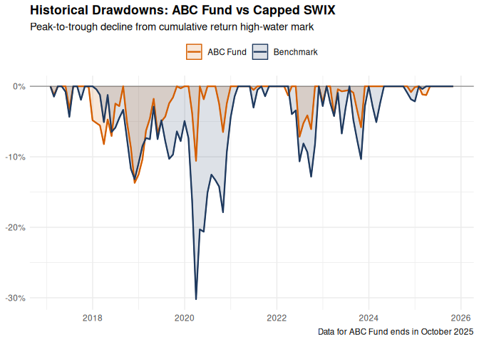<!-- -->

## Save charts for the slides

``` r
list(`1_beta` = beta_plot, `2_r2` = r2_plot, `3_drivers` = driver_plot, `4_fan` = fan_plot,
     `5_ranks` = rank_plot, `6_dispersion` = disp_plot, `7_slopes` = slopes_plot,`78_dd` = drawdown_plot) %>%
  iwalk(~ ggsave(file.path("figures", paste0(.y, ".png")), .x, width = 10.5, height = 5, dpi = 200, bg = "white"))
```

    ## `geom_smooth()` using formula = 'y ~ x'

    ## Warning: Removed 1 row containing missing values or values outside the scale range
    ## (`geom_segment()`).

# Question 4

``` r
Q4_data <- bind_rows(
  # 1. MSCI Global Indexes (Daily TRI -> Monthly Returns)
  daily_tri_to_monthly(MSCI),
  
  # 2. Local Vanilla + 2 Factor Indexes (Daily Returns -> Monthly Returns)
  daily_ret_to_monthly(
    Idx_Daily,
    keep_tickers = c("STXMOMJ433", "STXVALJ433", "J200", "J201")
  ),
  
  # 3. 10Y Global Bonds (Daily Yields -> Monthly Bond Total Returns)
  daily_yield_to_monthly_ret(Bond_Yields),
  
  # 4. LCL Yield Proxies (Already Monthly Returns)
  prep_monthly_lcl(LCL_Yield_Proxies),
  
  # 5. Commodities (Daily TRI -> Monthly Returns)
  daily_tri_to_monthly(Commods)
) %>%
  distinct(date, Tickers, .keep_all = TRUE) %>%
  arrange(date, Tickers)

# Spread into wide monthly return xts matrix for covariance estimation & optimization
return_mat <- Q4_data %>% filter(date >= "2015-01-31") %>% 
  spread(Tickers, Returns)

colSums(!is.na(return_mat))
```

    ##           date         ALBITR     BCOM Index         CILITR     CO1 Comdty 
    ##            141            141            141            141            141 
    ##  GTAUD10Y Corp  GTDEM10Y Corp  GTEUR10Y Govt  GTFRF10Y Corp  GTGBP10Y Corp 
    ##            141            141            141            141            141 
    ##  GTUSD10Y Govt           J200           J201           J253     MXCN Index 
    ##            141            141            141            141            141 
    ##     MXEF Index     MXEU Index     MXIN Index     MXJP Index     MXUS Index 
    ##            141            141            141            141            141 
    ##     MXWD Index     MXWO Index MXWO000G Index MXWO000V Index  MXWOMOM Index 
    ##            141            141            141            141            141 
    ## MXWOMVOL Index   MXWOQU Index   MXWOSM Index      RMZ Index     STXMOMJ433 
    ##            141            141            141            141            115 
    ##     STXVALJ433     XAU Curncy 
    ##            103            141

``` r
return_mat <- return_mat %>% impute_missing_returns(impute_returns_method = "Drawn_Distribution_Own") # Own distribution because the different assets vary
colSums(is.na(return_mat))
```

    ##           date         ALBITR     BCOM Index         CILITR     CO1 Comdty 
    ##              0              0              0              0              0 
    ##  GTAUD10Y Corp  GTDEM10Y Corp  GTEUR10Y Govt  GTFRF10Y Corp  GTGBP10Y Corp 
    ##              0              0              0              0              0 
    ##  GTUSD10Y Govt           J200           J201           J253     MXCN Index 
    ##              0              0              0              0              0 
    ##     MXEF Index     MXEU Index     MXIN Index     MXJP Index     MXUS Index 
    ##              0              0              0              0              0 
    ##     MXWD Index     MXWO Index MXWO000G Index MXWO000V Index  MXWOMOM Index 
    ##              0              0              0              0              0 
    ## MXWOMVOL Index   MXWOQU Index   MXWOSM Index      RMZ Index     STXMOMJ433 
    ##              0              0              0              0              0 
    ##     STXVALJ433     XAU Curncy 
    ##              0              0

``` r
return_mat_NO_DATE <- return_mat |> select(-date) |> as.matrix()

tickers <- colnames(return_mat_NO_DATE)
tickers
```

    ##  [1] "ALBITR"         "BCOM Index"     "CILITR"         "CO1 Comdty"    
    ##  [5] "GTAUD10Y Corp"  "GTDEM10Y Corp"  "GTEUR10Y Govt"  "GTFRF10Y Corp" 
    ##  [9] "GTGBP10Y Corp"  "GTUSD10Y Govt"  "J200"           "J201"          
    ## [13] "J253"           "MXCN Index"     "MXEF Index"     "MXEU Index"    
    ## [17] "MXIN Index"     "MXJP Index"     "MXUS Index"     "MXWD Index"    
    ## [21] "MXWO Index"     "MXWO000G Index" "MXWO000V Index" "MXWOMOM Index" 
    ## [25] "MXWOMVOL Index" "MXWOQU Index"   "MXWOSM Index"   "RMZ Index"     
    ## [29] "STXMOMJ433"     "STXVALJ433"     "XAU Curncy"

``` r
gamma_List <- seq(2, 150, by = 0.5) %>% as.list()
```

``` r
# Helper to safely extract unique tickers regardless of whether column is Ticker, Tickers, or Name
get_tickers <- function(df) {
  col_nm <- intersect(c("Tickers", "Ticker", "Name"), names(df))[1]
  unique(str_trim(as.character(df[[col_nm]])))
}

# 1. Inspect LCL_Yield_Proxies tickers so REITs are explicitly placed in Equities (not Bonds)
lcl_all   <- get_tickers(LCL_Yield_Proxies)
lcl_reits <- lcl_all[str_detect(lcl_all, regex("REIT|PROP|J253|SAPY", ignore_case = TRUE))]
lcl_bonds <- setdiff(lcl_all, lcl_reits)

# 2. Build one single source-of-truth classification table aligned to `tickers`
class_map <- tibble(Tickers = tickers) %>%
  mutate(
    Asset_Class = case_when(
      Tickers %in% c(get_tickers(Bond_Yields), lcl_bonds) ~ "Bonds",
      Tickers %in% get_tickers(Commods)                   ~ "Commodities",
      Tickers %in% c(get_tickers(MSCI), "STXMOMJ433", "STXVALJ433", "J200", "J201", lcl_reits) ~ "Equities",  #  Reits form part of Equities
      TRUE ~ "UNCLASSIFIED"
    ),
    Region = if_else(
      Tickers %in% c(get_tickers(MSCI), get_tickers(Bond_Yields), get_tickers(Commods)),
      "Global", "Local"
    )
  )

# AUDIT: Must return 0 rows! If anything prints here, add it to the case_when above
class_map %>% filter(Asset_Class == "UNCLASSIFIED")
```

    ## # A tibble: 0 × 3
    ## # ℹ 3 variables: Tickers <chr>, Asset_Class <chr>, Region <chr>

``` r
#tail_cols <- Amat[, (ncol(Amat) - 3):ncol(Amat)]
#colnames(tail_cols) <- c("neg_Bond", "neg_Equity", "neg_Comm", "neg_Global")
#colSums(tail_cols)

# 3. Rebuild group indicators & Amat directly from class_map
is_bond   <- as.numeric(class_map$Asset_Class == "Bonds")
is_equity <- as.numeric(class_map$Asset_Class == "Equities")
is_comm   <- as.numeric(class_map$Asset_Class == "Commodities")
is_global <- as.numeric(class_map$Region == "Global")

# Verify every asset belongs to exactly one asset class (must equal length(tickers))
all.equal(sum(is_bond + is_equity + is_comm), length(tickers))
```

    ## [1] TRUE

``` r
# 1. Start at 2010-01-31 so a 10-year (120-month) lookback covers 2020–2026 out-of-sample
return_mat_raw <- Q4_data %>%
  filter(date >= as.Date("2010-01-31")) %>%
  pivot_wider(names_from = Tickers, values_from = Returns) %>%
  arrange(date)

canonical_tickers <- return_mat_raw %>%
  select(-date) %>%
  names() %>%
  sort()

return_mat_raw <- return_mat_raw %>%
  select(date, all_of(canonical_tickers))

return_mat <- return_mat %>%
  select(date, all_of(canonical_tickers))

return_mat_NO_DATE <- return_mat %>%
  select(-date) %>%
  as.matrix()

# 3. Reorder class_map rows to match canonical_tickers 1-to-1
class_map <- class_map %>%
  arrange(match(Tickers, canonical_tickers))

stopifnot(identical(colnames(return_mat_NO_DATE), class_map$Tickers))

# 4. Rebuild Amat & bvec in that exact canonical order (with rownames attached)
N <- length(canonical_tickers)

is_bond   <- as.numeric(class_map$Asset_Class == "Bonds")
is_equity <- as.numeric(class_map$Asset_Class == "Equities")
is_comm   <- as.numeric(class_map$Asset_Class == "Commodities")
is_global <- as.numeric(class_map$Region == "Global")

raw_obs_counts <- colSums(!is.na(return_mat_raw %>% select(-date)))

A_eq  <- matrix(1, nrow = N, ncol = 1)
b_eq  <- 1

A_lb  <- diag(1, N)
b_lb  <- rep(0, N)

A_ub  <- -diag(1, N)
b_ub  <- if_else(raw_obs_counts >= 60, -0.35, 0.00)

A_grp <- cbind(-is_bond, -is_equity, -is_comm, -is_global)
b_grp <- c(-0.25, -0.75, -0.15, -0.60)

Amat <- cbind(A_eq, A_lb, A_ub, A_grp)
rownames(Amat) <- canonical_tickers
bvec <- c(b_eq, b_lb, b_ub, b_grp)

# 5. Recompute Sigma and mu from the canonically ordered matrix
Sigma <- RiskPortfolios::covEstimation(return_mat_NO_DATE, control = list(type = "lw"))
mu    <- colMeans(return_mat_NO_DATE, na.rm = TRUE)
```

``` r
# ==============================================================================
# 1A. TRACE THE CONSTRAINED EFFICIENT FRONTIER OVER YOUR gamma_List
# ==============================================================================
# Trace frontier using canonical_tickers
frontier_df <- purrr::map_dfr(
  gamma_List,
  ~ solve_frontier_gamma(.x, mu = mu, Sigma = Sigma, Amat = Amat, bvec = bvec, tickers = canonical_tickers)
)

# Extract key portfolios
w_minvol <- frontier_df %>% slice_max(gamma, n = 1, with_ties = FALSE) %>% pull(weights) %>% .[[1]] %>% rename(MinVol = Weight)
w_maxsr  <- frontier_df %>% slice_max(Sharpe_Ratio, n = 1, with_ties = FALSE) %>% pull(weights) %>% .[[1]] %>% rename(Max_Sharpe = Weight)
w_mv_mod <- frontier_df %>% filter(near(gamma, 5)) %>% pull(weights) %>% .[[1]] %>% rename(MV_Gamma5 = Weight)

# Constrained Equal Risk Contribution (ERC)
elig_idx <- which(b_ub < 0)
w_erc_uncon <- rep(0, N)
erc_try <- purrr::safely(RiskPortfolios::optimalPortfolio)(
  Sigma = Sigma[elig_idx, elig_idx, drop = FALSE],
  control = list(type = "erc", constraint = "lo")
)
w_erc_uncon[elig_idx] <- if (is.null(erc_try$error)) {
  as.numeric(erc_try$result)
} else {
  (1 / sqrt(diag(Sigma)[elig_idx])) / sum(1 / sqrt(diag(Sigma)[elig_idx]))
}
w_erc_sol <- quadprog::solve.QP(Dmat = diag(N), dvec = w_erc_uncon, Amat = Amat, bvec = bvec, meq = 1)$solution %>% pmax(0)
w_erc     <- tibble(Tickers = canonical_tickers, ERC = round(w_erc_sol / sum(w_erc_sol), 6))

# Combine static optimal weights & join directly with class_map
static_weights_df <- list(w_minvol, w_maxsr, w_mv_mod, w_erc) %>%
  purrr::reduce(left_join, by = "Tickers") %>%
  left_join(class_map, by = "Tickers")

# Verify group totals
static_weights_df %>%
  group_by(Asset_Class) %>%
  summarise(across(c(MinVol, Max_Sharpe, MV_Gamma5, ERC), sum))
```

    ## # A tibble: 3 × 5
    ##   Asset_Class MinVol Max_Sharpe MV_Gamma5   ERC
    ##   <chr>        <dbl>      <dbl>     <dbl> <dbl>
    ## 1 Bonds         0.25      0.190     0.100 0.25 
    ## 2 Commodities   0.15      0.15      0.15  0.134
    ## 3 Equities      0.6       0.660     0.75  0.616

``` r
static_weights_df %>%
  group_by(Region) %>%
  summarise(across(c(MinVol, Max_Sharpe, MV_Gamma5, ERC), sum))
```

    ## # A tibble: 2 × 5
    ##   Region MinVol Max_Sharpe MV_Gamma5   ERC
    ##   <chr>   <dbl>      <dbl>     <dbl> <dbl>
    ## 1 Global    0.6      0.435     0.466   0.6
    ## 2 Local     0.4      0.565     0.534   0.4

``` r
write_rds(static_weights_df, "Questions/Question 4/data/static_weights_df.rds")
```

This wraps your exact Sigma, means vector Amat and bvec solver into a
quarterly-rebalanced out-of-sample simulation (by = 3 months, minimum
120-month lookback), tracking intra-quarter weight drift, quarterly
turnover, and net-of-cost performance (15 bps transaction cost).

``` r
bt_results <- run_quarterly_backtest(return_mat_raw, Amat, b_eq, b_lb, b_grp, lookback_min = 120)
```

Some analytics Tables How did the Portfolio perform outside the sample
period?

``` r
#  OUT-OF-SAMPLE PERFORMANCE, TURNOVER & EFFECTIVE DIVERSIFICATION (N_EFF)
#  per optimisation strategy 

# Convert clean monthly return panel to xts (0-filled for pre-inception NAs; weights are 0 there anyway)
R_xts <- return_mat %>%
  mutate(across(-date, ~ coalesce(.x, 0))) %>%
  tbl_xts()

strategies <- c("MinVol", "MV_Gamma5", "Max_Sharpe", "ERC")


rp_oos_df <- purrr::map_dfr(
  strategies,
  ~ eval_strategy_rp(.x, reb_weights_df = bt_results$weights, R_xts = R_xts, tc_bps = 0.0015)
)
```

    ## Warning in PerformanceAnalytics::Return.portfolio(R = R, weights = weights, :
    ## First weights period is after the start of the data series. Setting weights for
    ## the preceding periods to equal weight.
    ## Warning in PerformanceAnalytics::Return.portfolio(R = R, weights = weights, :
    ## First weights period is after the start of the data series. Setting weights for
    ## the preceding periods to equal weight.
    ## Warning in PerformanceAnalytics::Return.portfolio(R = R, weights = weights, :
    ## First weights period is after the start of the data series. Setting weights for
    ## the preceding periods to equal weight.
    ## Warning in PerformanceAnalytics::Return.portfolio(R = R, weights = weights, :
    ## First weights period is after the start of the data series. Setting weights for
    ## the preceding periods to equal weight.

``` r
# Check clean out-of-sample summary stats
oos_summary_table <- rp_oos_df %>%
  group_by(Strategy) %>%
  summarise(
    Ann_Ret_Gross = Return.annualized(xts(Gross_Ret, order.by = date), scale = 12)[1] *100, 
    Ann_Ret_Net   = Return.annualized(xts(Net_Ret, order.by = date), scale = 12)[1] *100,
    Ann_Vol       = StdDev.annualized(xts(Net_Ret, order.by = date), scale = 12)[1] *100,
    Sharpe_Net    = SharpeRatio.annualized(xts(Net_Ret, order.by = date), Rf = 0.06 / 12, scale = 12)[1],
    Max_Drawdown  = maxDrawdown(xts(Net_Ret, order.by = date))*100,
    Avg_Qtr_TO    = mean(Turnover[Turnover > 1e-4]) *100,
    .groups       = "drop"
  )
oos_summary_table
```

    ## # A tibble: 4 × 7
    ##   Strategy  Ann_Ret_Gross Ann_Ret_Net Ann_Vol Sharpe_Net Max_Drawdown Avg_Qtr_TO
    ##   <chr>             <dbl>       <dbl>   <dbl>      <dbl>        <dbl>      <dbl>
    ## 1 ERC                8.84        8.83    12.1      0.267         28.4       4.07
    ## 2 MV_Gamma5         10.9        10.9     13.8      0.386         27.7      20.3 
    ## 3 Max_Shar…         10.1         9.99    13.2      0.337         28.8      17.8 
    ## 4 MinVol             8.35        8.32    11.6      0.232         23.9       8.69

``` r
write_rds(as.data.frame(oos_summary_table), "Questions/Question 4/data/oos_summary_table.rds")
```

``` r
# 3B. CAPITAL WEIGHTS VS. TRUE RISK CONTRIBUTION BY ASSET CLASS
# 3B. CAPITAL WEIGHTS VS. TRUE RISK CONTRIBUTION BY ASSET CLASS
risk_budget_table <- bt_results$weights %>%
  select(-any_of(c("Asset_Class", "Region"))) %>%
  left_join(class_map, by = "Tickers") %>%
  group_by(reb_date, Asset_Class) %>%
  summarise(
    W_MinVol = sum(MinVol),     RC_MinVol = sum(RC_MinVol),
    W_MV5    = sum(MV_Gamma5),  RC_MV5    = sum(RC_MV5),
    W_MaxSR  = sum(Max_Sharpe), RC_MaxSR  = sum(RC_MaxSR),
    W_ERC    = sum(ERC),        RC_ERC    = sum(RC_ERC),
    .groups  = "drop"
  ) %>%
  group_by(Asset_Class) %>%
  summarise(across(starts_with(c("W_", "RC_")), mean), .groups = "drop")

risk_budget_table
```

    ## # A tibble: 3 × 9
    ##   Asset_Class W_MinVol  W_MV5 W_MaxSR W_ERC RC_MinVol  RC_MV5 RC_MaxSR RC_ERC
    ##   <chr>          <dbl>  <dbl>   <dbl> <dbl>     <dbl>   <dbl>    <dbl>  <dbl>
    ## 1 Bonds          0.250 0.240   0.245  0.25      0.114 0.413    0.257    0.132
    ## 2 Commodities    0.147 0.0100  0.0130 0.129     0.162 0.00251  0.00507  0.115
    ## 3 Equities       0.603 0.750   0.742  0.621     0.724 0.585    0.738    0.753

``` r
write_rds(risk_budget_table, "Questions/Question 4/data/risk_budget_table.rds")
```

``` r
#  REGIME STRESS ATTRIBUTION (2020 COVID VS. 2022 RATE SHOCK VS. POST-2023)

regime_table <- bt_results$returns %>%
  mutate(
    Regime = case_when(
      date <= as.Date("2020-06-30") ~ "1. 2020 COVID Shock",
      date >= as.Date("2022-01-01") & date <= as.Date("2022-12-31") ~ "2. 2022 Inflation & Rate Shock",
      TRUE ~ "3. Recovery & Normalization"
    )
  ) %>%
  group_by(Regime, Strategy) %>%
  summarise(
    Cum_Net_Return = prod(1 + Net_Ret) - 1,
    Ann_Vol        = sd(Net_Ret) * sqrt(12),
    Worst_Month    = min(Net_Ret),
    .groups        = "drop"
  ) %>%
  pivot_wider(names_from = Strategy, values_from = Cum_Net_Return, id_cols = Regime)

regime_table
```

    ## # A tibble: 3 × 5
    ##   Regime                             ERC MV_Gamma5 Max_Sharpe  MinVol
    ##   <chr>                            <dbl>     <dbl>      <dbl>   <dbl>
    ## 1 1. 2020 COVID Shock            -0.0741   -0.0453    -0.0403 -0.0551
    ## 2 2. 2022 Inflation & Rate Shock -0.0217   -0.0327    -0.0681 -0.0230
    ## 3 3. Recovery & Normalization     1.41      1.22       1.35    1.09

``` r
write_rds(regime_table, "Questions/Question 4/data/regime_table.rds")
```

Figures

``` r
# 1. Constrained Mean-Variance Efficient Frontier (from your gamma_List)
key_pts <- frontier_df %>%
  filter(near(gamma, 150) | near(gamma, 5) | Sharpe_Ratio == max(Sharpe_Ratio)) %>%
  mutate(Label = case_when(
    near(gamma, 150) ~ "MinVol (High Gamma)",
    near(gamma, 5)   ~ "Moderate MV (Gamma = 5)",
    TRUE             ~ "Max Sharpe (Tangency)"
  ))
```

``` r
tibble(
  Tickers        = tickers,
  Ann_Arith_Ret  = mu * 12,
  Ann_Vol        = sqrt(diag(Sigma)) * sqrt(12),
  Approx_CAGR    = (mu * 12) - 0.5 * (diag(Sigma) * 12)
) %>%
  arrange(desc(Ann_Arith_Ret)) %>%
  print(n = 15)
```

    ## # A tibble: 31 × 4
    ##    Tickers        Ann_Arith_Ret Ann_Vol Approx_CAGR
    ##    <chr>                  <dbl>   <dbl>       <dbl>
    ##  1 GTFRF10Y Corp          3.39   10.1      -47.2   
    ##  2 GTGBP10Y Corp          0.405   0.951     -0.0465
    ##  3 STXVALJ433             0.195   0.173      0.180 
    ##  4 STXMOMJ433             0.170   0.173      0.155 
    ##  5 GTUSD10Y Govt          0.153   0.390      0.0774
    ##  6 MXWOMOM Index          0.148   0.157      0.135 
    ##  7 MXWO000G Index         0.143   0.164      0.130 
    ##  8 MXUS Index             0.141   0.151      0.129 
    ##  9 MXWOQU Index           0.139   0.147      0.128 
    ## 10 CO1 Comdty             0.138   0.414      0.0526
    ## 11 GTAUD10Y Corp          0.138   0.420      0.0498
    ## 12 MXWO Index             0.123   0.146      0.112 
    ## 13 XAU Curncy             0.119   0.157      0.107 
    ## 14 MXWD Index             0.119   0.144      0.108 
    ## 15 J200                   0.116   0.150      0.104 
    ## # ℹ 16 more rows

``` r
p_frontier <- ggplot(frontier_df, aes(x = Ann_Vol, y = Ann_Arith_Ret , color = Sharpe_Ratio)) +
  geom_path(linewidth = 1.2) +
  geom_point(data = key_pts, size = 3.5, color = "#1B4F72") +
  ggrepel::geom_label_repel(
    data = key_pts, aes(label = Label),
    size = 3.2, fontface = "bold", color = "#1B4F72", fill = "white"
  ) +
  scale_color_viridis_c(option = "plasma", name = "Sharpe Ratio") +
  scale_x_continuous(labels = percent_format(accuracy = 0.1)) +
  scale_y_continuous(labels = percent_format(accuracy = 0.1)) +
  labs(
    title    = "Constrained Global Balanced Efficient Frontier (Post-2010 Ledoit-Wolf Sigma)",
    subtitle = "Subject to Long-Only, Single <= 35%, Bonds <= 25%, Equities <= 75%, Commods <= 15%, Global <= 60%",
    x        = "Annualized Portfolio Volatility",
    y        = "Annualized Expected Return"
  ) +
  theme_minimal(base_size = 11) +
  theme(plot.title = element_text(face = "bold", hjust = 0),
        plot.title.position = "plot",
        plot.subtitle = element_text(hjust = 0))
p_frontier
```

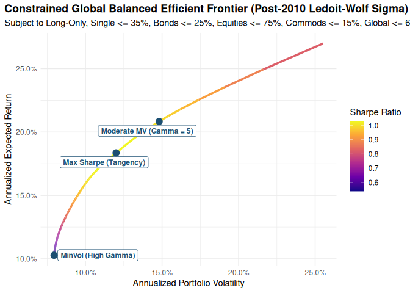<!-- -->

``` r
ggsave("figures/p_frontier.png", p_frontier, height = 4, width = 8.5)
ggsave("Questions/Question 4/figures/p_frontier.png", p_frontier, height = 4, width = 8.5)
```

``` r
p_oos_wealth <- bt_results$returns %>%
  group_by(Strategy) %>%
  arrange(date) %>%
  mutate(Wealth = cumprod(1 + Net_Ret)) %>%
  ggplot(aes(x = date, y = Wealth, color = Strategy)) +
  geom_line(linewidth = 1.05) +
  scale_color_manual(values = c(
    "MinVol"     = "#1B4F72",
    "MV_Gamma5"  = "#D35400",
    "Max_Sharpe" = "#8E44AD",
    "ERC"        = "#1E8449"
  )) +
  labs(
    title    = "Quarterly Rebalanced Out-of-Sample Cumulative Wealth (10-Year Rolling Lookback)",
    subtitle = "Net of 15 bps quarterly rebalancing costs; all brief constraints enforced at every rebalance date",
    x        = NULL,
    y        = "Cumulative Wealth (Base = 1.00)"
  ) +
  theme_minimal(base_size = 11) +
  theme(legend.position = "top", 
        plot.title = element_text(face = "bold", hjust = 0),
        plot.title.position = "plot",
        plot.subtitle = element_text(hjust = 0))

p_oos_wealth
```

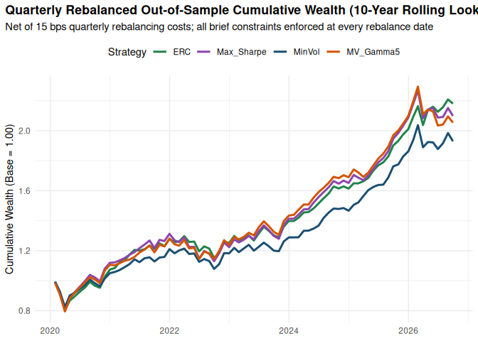<!-- -->

``` r
ggsave("figures/p_oos_wealth.png", p_oos_wealth, height = 4, width = 8.5)
ggsave("Questions/Question 4/figures/p_oos_wealth.png", p_oos_wealth, height = 4, width = 8.5)
```

``` r
# 3. Capital Weights vs. Risk Contribution Comparison
p_risk_comp <- risk_budget_table %>%
  pivot_longer(-Asset_Class, names_to = "Metric", values_to = "Share") %>%
  separate(Metric, into = c("Type", "Strategy"), sep = "_", extra = "merge") %>%
  mutate(Type = recode(Type, "W" = "Capital Weight (%)", "RC" = "Risk Contribution (%)")) %>%
  ggplot(aes(x = Strategy, y = Share, fill = Asset_Class)) +
  geom_col(position = "stack", width = 0.58) +
  facet_wrap(~ Type) +
  scale_y_continuous(labels = percent_format(accuracy = 1)) +
  scale_fill_manual(values = c("Equities" = "#2E86C1", "Bonds" = "#28B463", "Commodities" = "#F39C12")) +
  labs(
    title    = "Capital Allocation vs. True Portfolio Risk Contribution",
    subtitle = "Illustrating how Equities dominate variance in MV portfolios compared to MinVol and ERC",
    x        = NULL,
    y        = "Portfolio Share (%)",
    fill     = "Asset Class"
  ) +
  theme_minimal(base_size = 11) +
  theme(legend.position = "top", 
        plot.title = element_text(face = "bold", hjust = 0),
        plot.title.position = "plot",
        plot.subtitle = element_text(hjust = 0))
p_risk_comp
```

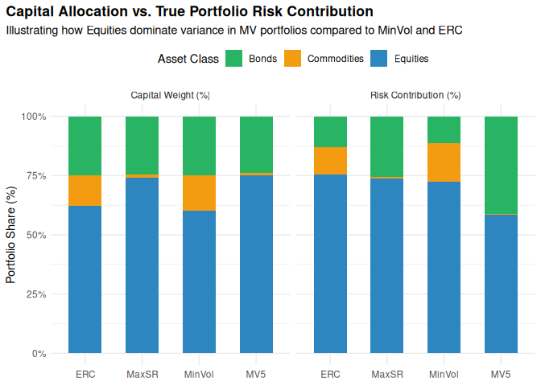<!-- -->

``` r
ggsave("figures/p_risk_comp.png", p_risk_comp, height = 4, width = 8.5)
ggsave("Questions/Question 4/figures/p_risk_comp.png", p_risk_comp, height = 4, width = 8.5)
```
